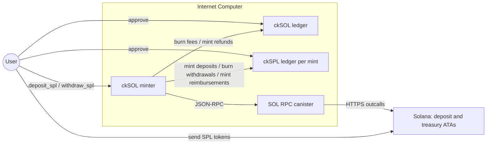
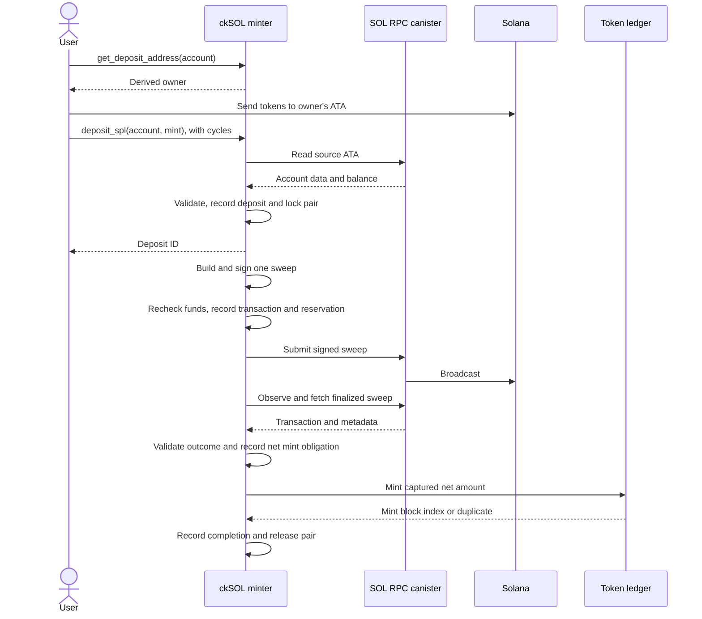
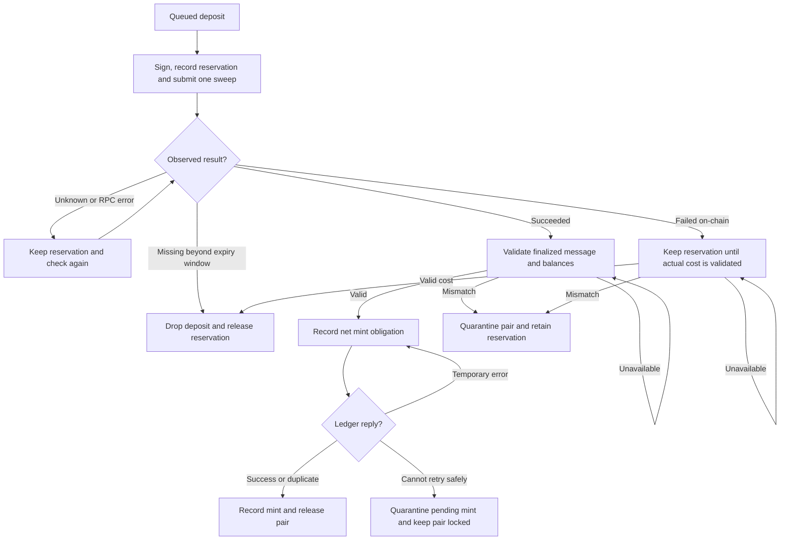
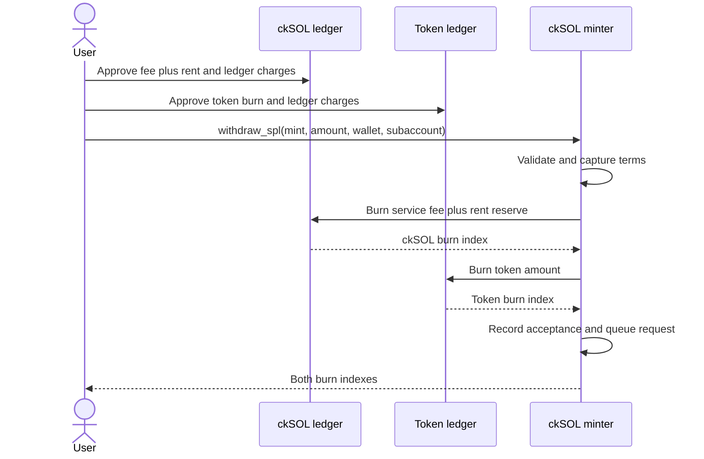
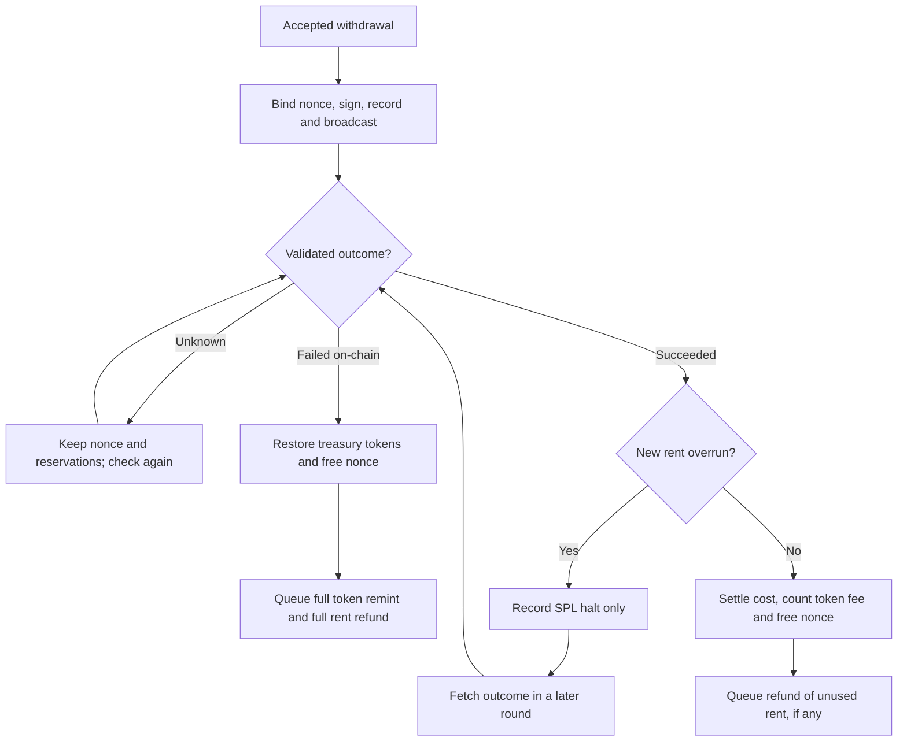

# Chain-Key SPL Token (ckSPL) Design

> **Status:** This document describes a design whose implementation is under review. The code is not yet part of the `main` branch; it follows in separate pull requests. The document describes the state after all of them are merged.

- [1. High-Level Goal](#1-high-level-goal)
- [2. Overview](#2-overview)
- [3. Technical Details](#3-technical-details)
  - [3.1. Converting SPL to ckSPL](#31-converting-spl-to-ckspl)
  - [3.2. Converting ckSPL to SPL](#32-converting-ckspl-to-spl)
  - [3.3. Fees and Minimum Amounts](#33-fees-and-minimum-amounts)
  - [3.4. Registration and Operating Funds](#34-registration-and-operating-funds)
  - [3.5. Events and Upgrades](#35-events-and-upgrades)
  - [3.6. API](#36-api)
  - [3.7. Ledger Memos](#37-ledger-memos)
  - [3.8. Metrics](#38-metrics)
  - [3.9. OFAC Checks](#39-ofac-checks)
- [4. How to register a new ckSPL token](#4-how-to-register-a-new-ckspl-token)

## 1. High-Level Goal

The ckSOL minter supports classic SPL tokens through separate ICRC ledgers. A user deposits tokens on Solana and receives the corresponding ckSPL tokens on the Internet Computer. To withdraw, the user burns ckSPL and pays the fee and reserved rent in ckSOL.

This design describes the SPL implementation built on ckSOL v0.2.0. It does not describe deployment status. Token registration is a separate proposal and must follow the availability of both deposits and withdrawals.

## 2. Overview

The minter uses the same main Solana address, derived deposit owners and signing infrastructure as [ckSOL](design.md#2-overview). Each supported mint has its own treasury associated token account (ATA) and its own ckSPL ledger. The minter's default IC account is the minting account on that ledger, as on the ckSOL ledger.

A deposit moves tokens from a user's derived ATA to the treasury before minting ckSPL. A withdrawal burns ckSPL before moving tokens out of the treasury. Token fees remain in the treasury as surplus; they are not minted to a fee collector.



SPL deposits are manual, with one deposit per sweep. SPL withdrawals use one request per durable-nonce transaction. SOL deposits and withdrawals keep their batching. Token-2022, automatic SPL scanning and shared multichain ledgers are not part of this implementation.

## 3. Technical Details

### 3.1. Converting SPL to ckSPL

#### 3.1.1. Manual Flow

A user first obtains a deposit owner with `get_deposit_address`. This uses the same account-based derivation as [SOL deposits](design.md#31-converting-sol-to-cksol). The user sends tokens to the ATA derived from that owner and the selected mint. The wallet owner address and the ATA address are different: the minter returns the owner, not a separate SPL deposit address.

The caller then invokes `deposit_spl` with the beneficiary's optional principal and subaccount, and the mint. As in the [manual SOL flow](design.md#312-manual-flow), another caller may pay the cycles for the beneficiary. The caller attaches the cycle budget reported by `get_minter_info.deposit_spl_required_cycles`.

The minter checks that the token is registered and deposits are not paused. It reads the source ATA and verifies its program, mint, owner, account state and balance. The treasury is not read here. The gross balance must cover the token's net deposit minimum plus its deposit fee.

Acceptance records the source balance and fee in `QueuedSplDeposit` and returns a sequential `DepositSplId`. The `(IC account, mint)` pair stays locked until the deposit is minted, dropped or manually recovered from quarantine. Calling again while the pair is processing returns its existing ID. A quarantined pair returns a `Quarantined` error. Other pairs remain independent.

The source RPC cost is charged even when the read fails. The consolidation charge is collected only when a new deposit is queued. Registration, pause and token amount settings are checked again after the read. A deposit queued during that read is returned instead of queueing the same balance twice.



`watch_deposit_address` still detects SOL only. Sending SPL tokens alone does not queue a sweep.

#### 3.1.2. Transaction Submission

SPL sweeps use recent blockhashes, as in [ckSOL transaction submission](design.md#313-transaction-submission). A sweep contains one classic `TransferChecked` from the source ATA to the treasury ATA. Both accounts must already exist. The deposit owner authorizes the transfer, and the minter's main address pays the Solana fee, so each sweep needs two signatures.

The sweep timer runs every minute and selects at most five deposits per round. Selection uses a rotating cursor and is limited by available operating SOL. The minter checks funding before signing and again after signing. It then records the signed transaction and reserves its SOL cost before broadcasting it.

The treasury ATA is created before token registration, not by a sweep. Deposit ATAs are left open after sweeping. A submission error does not by itself prove that the transaction failed; the recorded sweep remains under observation.

#### 3.1.3. Finalization and Minting

SOL and SPL sweeps share the status monitor. It reads a finalized block-height snapshot, then calls `getSignatureStatuses` with history search. An unknown signature expires only when it is more than 150 blocks old. A failed call or a reply of the wrong length gives no evidence of expiry. Above 2,560 in-flight sweeps, status selection rotates across rounds.

A successful status is not enough to mint. The minter fetches the finalized transaction and verifies its message, SOL cost, token accounts and token balance changes. It uses the shared sweep-settlement helper, with additional SPL checks. Valid settlement records the net mint obligation, counts the captured token fee and releases the unused SOL reservation.



An observed on-chain failure cannot later expire as a zero-cost missing sweep. Its deposit stays locked until the actual cost is settled. A failed or expired deposit is dropped without minting; the user calls `deposit_spl` again to sweep the remaining balance. There is no batch splitting or automatic individual retry.

Minting uses the same retry and quarantine helper as the [ckSOL manual flow](design.md#312-manual-flow), with a separate SPL timer, guard and cursor. Retries keep the same amount, beneficiary, memo and creation time. A duplicate reply completes the mint. An expired deduplication window, a definitive rejection or an unresolved callback trap causes quarantine. Before manual recovery, operators must check the ledger for a mint that already landed.

### 3.2. Converting ckSPL to SPL

#### 3.2.1. Submitting Withdrawal Requests

The user approves the minter on both ledgers, then calls `withdraw_spl` with the mint, token amount, destination wallet and optional source subaccount. Both burns use the caller's IC account. The amount is in token units, not lamports.

The minter checks registration, the destination, the SPL halt and the presence of nonce accounts before burning. The amount must exceed `withdrawal_fee_token`, so the recipient gets a positive amount. There is no other configured withdrawal minimum; the token ledger enforces its own burn minimum.

The destination checks reuse [ckSOL's withdrawal validation](design.md#324-submitting-withdrawal-requests). SPL also rejects the selected treasury ATA and off-curve wallet addresses. This excludes PDA wallets such as off-curve multisig vaults. The destination ATA is not read before submission; Solana checks it during execution.

The minter burns the ckSOL service fee plus rent reserve first, then burns the token amount. A guard prevents concurrent SOL or SPL withdrawal calls from the same IC account. After both burns succeed, `AcceptedSplWithdrawalRequest` records the terms and both burn indexes.

The ckSOL burn index is the withdrawal ID. It is also used to order requests alongside SOL withdrawals. Token burn indexes are interpreted with their ledger ID, since different token ledgers can return the same index.



| Burn result | Action |
| --- | --- |
| ckSOL burn fails | Return an error; do not attempt the token burn |
| Token burn returns a call error, temporary unavailability or generic ledger error | Queue a refund of the full burned ckSOL amount |
| Token burn returns insufficient funds, insufficient allowance or `BadBurn` | Queue a refund of burned ckSOL minus one ckSOL ledger fee, currently 500 lamports |
| Token burn returns `BadFee`, `TooOld`, `CreatedInFuture` or `Duplicate` | Trap as an unexpected ledger response; no automatic refund is recorded by this path |

The 500 lamports are a constant of the minter, `CKSOL_LEDGER_TRANSACTION_FEE`. The minter does not read the fee from the ckSOL ledger, so a change of the ledger fee needs a code upgrade.

Acceptance means the request is queued, not that tokens have been sent. There is no durable checkpoint between the ledger burns and acceptance. A callback trap in that gap can require manual ledger reconciliation. Withdrawal burns do not use the durable refill-intent mechanism described in section 3.4.

#### 3.2.2. Transaction Submission

SOL and SPL requests share one processing round and the [durable nonce pool](design.md#321-durable-nonce-accounts). Requests are ordered by their ckSOL burn indexes. SOL keeps its batching; each SPL request runs alone. If one kind cannot be funded, the other can still use available funds and nonce accounts.

The round uses temporary SOL and per-mint token budgets so selected plans do not reserve the same funds twice. It reads a free nonce account, verifies its authority and checks funds again. `CreatedSplWithdrawalTransaction` binds the request to that nonce value before signing. A signing failure retains the binding for an identical retry.

The transaction contains three instructions:

1. Advance the durable nonce.
2. Create the recipient's ATA with `CreateIdempotent`.
3. Transfer `amount - withdrawal_fee_token` from the treasury with `TransferChecked`.

Creating the transaction reserves 5,000 lamports for the transaction fee plus the captured rent reserve from the tracked main balance, and the transfer amount from the treasury token balance of the mint. Settlement returns the unused part.

The minter is the fee payer, treasury owner and nonce authority, so it signs alone. There is no destination-creation flag. ATA creation spends no rent when the account already exists. The signed message and signature are recorded before the RPC broadcast call.

#### 3.2.3. Finalization and Reimbursements

Withdrawal observation reuses [ckSOL's nonce monitoring and rebroadcast](design.md#325-finalization-and-re-broadcast). An unchanged nonce allows rebroadcast of the same signed transaction after 90 seconds. An advanced nonce causes the minter to fetch and validate the finalized message and metadata. Missing or inconsistent data leaves the outcome unresolved.



**Transfer succeeds.** The minter settles the actual SOL cost, counts the retained token fee and frees the nonce. Unused rent is refunded in ckSOL. The transaction stays successful while that refund is pending.

**Transfer fails definitively.** No tokens moved and no ATA was created. The minter restores the treasury reservation, frees the nonce, queues a remint of the full burned token amount and refunds the full rent reserve. The ckSOL service fee is kept. There is no new transfer attempt or new burn.

**Outcome is unknown.** The nonce and reservations remain held. An RPC error does not cause reimbursement or a replacement transaction with another nonce.

Token remints and ckSOL refunds are separate obligations on separate ledgers. Both use the shared mint helper with fixed retry arguments. Temporary errors remain pending, duplicate replies complete the obligation, and unsafe retries are quarantined for manual resolution.

#### 3.2.4. Automatic SPL Halt

A successful withdrawal can reveal that destination rent is higher than expected. The minter compares actual rent with the larger of the captured and current reserves. If it exceeds both and SPL withdrawals are not already halted, that round records only `HaltedSplWithdrawals`. A later round attempts settlement. A trap in that later settlement cannot undo the earlier halt.

While halted, new requests return `WithdrawalsHalted` before either burn. Calls whose burns already began may finish acceptance and wait. Queued and created SPL transactions are held; transactions already signing may finish and broadcast. Held transactions do not consume signing-round capacity, but they keep their nonce bindings. SOL withdrawals can proceed when funds and a free nonce are available.

A held transaction keeps its nonce account until the resume. If held transactions occupy every nonce account, SOL withdrawals wait as well. Operators can restore SOL withdrawals during a halt by adding nonce accounts with `nonce_accounts_to_add`.

Sent transactions, remints and refunds continue to be processed. Only an upgrade with `spl_withdrawals_halted = opt false` resumes new SPL processing. `opt true` halts it manually; omission preserves the state. A refill does not clear the halt.

Held requests retain their captured reserve. Raising the reserve requires a code upgrade, and a resume does not increase the amount already burned. If excess rent exceeds the tracked unreserved SOL balance, settlement can still trap until funds permit reconciliation. The halt remains set. Deficit reconciliation and refunds for held requests are separate future work.

### 3.3. Fees and Minimum Amounts

Clients read current settings from `get_minter_info`. Token amounts use the mint's smallest units; ckSOL amounts use lamports. Ledger transfer and approval charges are additional, as described for [ckSOL ledger fees](design.md#331-cksol-ledger-fees).

```text
minimum gross deposit = minimum_deposit_amount + deposit_fee
ckSPL minted          = accepted balance - captured deposit_fee
ckSOL withdrawal burn = withdrawal_fee_cksol + refundable_rent
SPL received          = amount - captured withdrawal_fee_token
rent refund on success = max(captured reserve - actual rent, 0)
```

| Setting | Initial value and unit |
| --- | --- |
| `minimum_deposit_amount`, `deposit_fee` | Per-token registration values, in token units |
| `withdrawal_fee_token` | Per token; omitted registration value means zero |
| `spl_deposit_consolidation_fee` | 70,000,000,000 cycles, plus the source RPC budget of 10,000,000,000 cycles |
| `spl_withdrawal_fee` | 1,000,000 lamports of ckSOL; exposed per token as `withdrawal_fee_cksol` |
| `refundable_rent` | Code constant of 2,039,280 lamports of ckSOL |

The deposit minimum is positive and applies after deducting the token fee. The withdrawal needs only `amount > withdrawal_fee_token`; the deposit minimum does not apply. `SplTokenInfo.minimum_withdrawal_amount` reports that limit, `withdrawal_fee_token + 1`; it is derived, not a setting. There is no numeric ledger burn minimum in `SplTokenInfo`. A ledger rejection can therefore occur after the ckSOL burn and incur the reimbursement deduction above.

Accepted terms survive later fee changes. The SPL service fee is separate from the SOL withdrawal fee. The rent reserve has a compile-time check against `(165 + 128) * 6,960`. It is not an upgrade-argument setting. If service fee plus rent overflows, the withdrawal is rejected; the informational total in token discovery saturates at `nat64` maximum.

The initialization and upgrade code enforces these constraints. An upgrade that violates one traps and is rolled back:

1. **`spl_withdrawal_fee` ≥ 5,000 lamports**: the minter pays the transaction fee of an SPL withdrawal from this fee.
2. **`minimum_deposit_amount` > 0**, and `minimum_deposit_amount + deposit_fee` must fit in `nat64`.
3. **Token program**: only the classic SPL Token program is accepted.
4. **Symbol**: non-empty ASCII of at most 20 bytes.
5. **Ledger and index IDs**: not the anonymous or management principal, and not already in use by another token, the ckSOL ledger or the SOL RPC canister.
6. **Refill settings**: when enabled, `0 < low_water_mark < target`.

`withdrawal_fee_token` has no constraint; zero is allowed.

### 3.4. Registration and Operating Funds

Tokens are registered with `UpgradeArgs.add_spl_tokens`, not a public endpoint or an orchestrator call. Registration supplies the mint, classic program, decimals, ledger ID, optional index ID, symbol, deposit minimum, deposit fee, deposit pause and optional token withdrawal fee.

The minter validates syntax, program, symbols, amount bounds and registry identities without RPC or ledger calls. Each mint is registered once. Ledger/index IDs cannot be reused or collide with the ckSOL ledger or SOL RPC canister. Mint properties, ledger setup and treasury accounts are checked through the registration checklist, not during the upgrade. An invalid upgrade traps and is rolled back by the IC.

`update_spl_tokens` can change the deposit minimum, deposit fee, deposit pause and token withdrawal fee. Other registration fields stay fixed. Omitted fields retain their values; explicit zero or false sets them. A deposit pause stops new deposits but leaves accepted work and withdrawals active. There is no per-token withdrawal pause.

The minter's main SOL account pays for deposit sweeps. An operating-balance counter tracks SOL that does not back issued ckSOL and may pay those costs. Each submitted sweep reserves 10,000 lamports from this counter and the tracked main balance. Settlement returns the unused part. A quarantined sweep keeps its reservation.

Operators fund the ckSOL top-up account returned by `get_operating_balance`, the minter's `0xbeef` subaccount. Automatic refill burns from that account, reducing the amount of ckSOL that must be backed while leaving SOL at the main address. The operating balance is credited only after the burn succeeds or is deduplicated.

Refills default to enabled, a low-water mark of 10,000,000 lamports and a target of 100,000,000. A new refill starts below the low-water mark and is capped by available top-up ckSOL. Its intent is recorded before the ledger call. Retries keep the same amount, memo and timestamp. Definitive first-attempt failures clear it; uncertain outcomes that cannot be retried safely are quarantined. Disabling refills does not discard a pending intent.

SPL withdrawal fee surplus credits operating funds after the actual transaction fee and excess rent. A cost above the service fee debits operating funds; any uncovered amount becomes an operating shortfall. Later operating credits repair that shortfall first. This does not remove the main-balance settlement limit in section 3.2.4.

### 3.5. Events and Upgrades

The minter uses [ckSOL's event log and replay](design.md#35-events). Replay restores configuration, accepted terms, reservations, nonce bindings, pending mints and refunds. The explicit halt is replayed as recorded; it is not recalculated from historical transaction costs. Queue cursors and task guards are transient.

Existing event tags and payload encodings stay unchanged. The following tags are appended. Numbers before payload fields are their CBOR indices; the outer event timestamp remains separate.

| Tag | Event | Payload |
| --- | --- | --- |
| 16 | `QueuedSplDeposit` | 0: `deposit_id`; 1: `account`; 2: `mint`; 3: source ATA `address`; 4: `balance`; 5: `fee` |
| 17 | `CreditedSplSweep` | 0: `signature`; 1: `lamports_spent`; 2: `deposit_id`; 3: `amount_to_mint` |
| 18 | `QuarantinedSplSweep` | 0: `signature` |
| 19 | `MintedSweptSplDeposit` | 0: `deposit_id`; 1: `mint_block_index` |
| 20 | `QuarantinedPendingSplMint` | 0: `deposit_id` |
| 21 | `RequestedOperatingRefill` | 0: `refill_id`; 1: `amount`; 2: `created_at_time` |
| 22 | `CompletedOperatingRefill` | 0: `refill_id`; 1: `burn_block_index` |
| 23 | `FailedOperatingRefill` | 0: `refill_id`; 1: `reason` |
| 24 | `QuarantinedOperatingRefill` | 0: `refill_id` |
| 25 | `AcceptedSplWithdrawalRequest` | 0: request, defined below |
| 26 | `FailedSplWithdrawalRequest` | 0: `cksol_burn_block_index`; 1: `to`; 2: `reimbursed_amount` |
| 27 | `CreatedSplWithdrawalTransaction` | 0: `cksol_burn_block_index`; 1: `nonce_account`; 2: `nonce_value` |
| 28 | `SucceededSplWithdrawalTransaction` | 0: `signature`; 1: `lamports_spent`; 2: `rent_spent` |
| 29 | `FailedSplWithdrawalTransaction` | 0: `signature`; 1: `lamports_spent` |
| 30 | `QueuedSplCkSolRefund` | 0: `cksol_burn_block_index`; 1: `kind`; 2: `to`; 3: `amount`; 4: `created_at_time` |
| 31 | `ReimbursedSplCkSol` | 0: `cksol_burn_block_index`; 1: `kind`; 2: `mint_block_index` |
| 32 | `QuarantinedSplCkSolRefund` | 0: `cksol_burn_block_index`; 1: `kind` |
| 33 | `ReimbursedSplWithdrawal` | 0: `cksol_burn_block_index`; 1: `mint_block_index` |
| 34 | `QuarantinedSplWithdrawalReimbursement` | 0: `cksol_burn_block_index` |
| 35 | `FailedSplSweep` | 0: `signature`; 1: `lamports_spent` |
| 36 | `HaltedSplWithdrawals` | 0: `signature`; 1: `rent_spent`; 2: `rent_reserve` |

The accepted request contains 0: `terms`, 1: `cksol_burn_block_index`, and 2: `ckspl_burn_block_index`. Its captured terms are:

| Index | Field | Unit or meaning |
| --- | --- | --- |
| 0 | `account` | Source IC account |
| 1 | `mint` | SPL mint address |
| 2 | `ledger_id` | Token ledger principal |
| 3 | `address` | Destination wallet |
| 4 | `amount` | Token units burned |
| 5 | `token_fee` | Token units retained on success |
| 6 | `fee` | ckSOL service fee in lamports |
| 7 | `rent_reserve` | ckSOL rent reserve in lamports |

`SubmittedTransaction` adds purpose tag 5, `SweepSplDeposit` (0: `deposit_id`, 1: `block_height`), and tag 6, `SplWithdrawal` (0: `cksol_burn_block_index`). The existing success, failure and expiry events dispatch by transaction kind. For an SPL sweep, `FailedTransaction` records an observed failure; `FailedSplSweep` later settles its cost. Each event has a corresponding public `get_events` representation. Refund `kind` uses tag 0 for `FailedTokenBurn`, 1 for `UnusedRent`, and 2 for `FailedTransferRent`.

New upgrade fields follow existing indices 0–7:

| CBOR index | Field | Candid type |
| --- | --- | --- |
| 8 | `add_spl_tokens` | `opt vec SplTokenRegistration` |
| 9 | `update_spl_tokens` | `opt vec SplTokenUpdate` |
| 10 | `operating_balance_refill` | `opt OperatingRefillConfig` |
| 11 | `spl_deposit_consolidation_fee` | `opt nat64` |
| 12 | `spl_withdrawal_fee` | `opt nat64` |
| 13 | `spl_withdrawals_halted` | `opt bool` |

`SplTokenRegistration` has these fields:

| Index | Field | Candid type |
| --- | --- | --- |
| 0 | `mint` | `text` |
| 1 | `token_program` | `text` |
| 2 | `decimals` | `nat8` |
| 3 | `ledger_id` | `principal` |
| 4 | `index_id` | `opt principal` |
| 5 | `symbol` | `text` |
| 6 | `minimum_deposit_amount` | `nat64` |
| 7 | `deposit_fee` | `nat64` |
| 8 | `deposits_paused` | `bool` |
| 9 | `withdrawal_fee_token` | `opt nat64` |

`SplTokenUpdate` identifies the mint at index 0. Its optional settings are 1: `minimum_deposit_amount`, 2: `deposit_fee`, 3: `deposits_paused`, and 4: `withdrawal_fee_token`. Each setting is optional: amount settings use `opt nat64`, and the pause uses `opt bool`.

`OperatingRefillConfig` uses 0: `enabled` (`bool`), 1: `low_water_mark` (`nat64`), and 2: `target` (`nat64`). When enabled, `0 < low_water_mark < target` is required. Omitted upgrade fields preserve their values. These indices are distinct from Candid's field-name hashes. Payload types and codecs are defined in `minter/src/state/event.rs` and `libs/types-internal/src/lib.rs`.

### 3.6. API

The existing [ckSOL API](design.md#36-api) is extended with these endpoints. The exact public types are in `minter/cksol_minter.did` and `libs/types/src/lib.rs`.

| Endpoint | Mode | Arguments and result |
| --- | --- | --- |
| `get_deposit_address` | Update | Existing account arguments; returns the owner shared by SOL and SPL deposits |
| `deposit_spl` | Update | `{ owner : opt principal; subaccount : opt blob; mint : Address }`; returns a deposit ID or `DepositSplError` |
| `deposit_spl_status` | Query | Deposit ID; returns `DepositSplStatus` |
| `withdraw_spl` | Update | `{ mint : Address; from_subaccount : opt blob; amount : nat64; address : text }`; returns both burn indexes or `WithdrawSplError` |
| `withdraw_spl_status` | Update | `{ cksol_burn_block_index : nat64 }`; returns `WithdrawSplStatus` |
| `get_operating_balance` | Query | No arguments; returns operating `balance` and the ckSOL `top_up_account` |
| `get_minter_info` | Query | Existing result plus token discovery, deposit cycle charges, collected token fees and the SPL halt flag |

`Address` is base58 text; deposit and withdrawal IDs are `nat64`. A token discovery entry includes mint/program/decimals, ledger/index IDs, symbol, deposit minimum/fee, deposit pause, `withdrawal_fee_token`, `minimum_withdrawal_amount`, `withdrawal_fee_cksol`, `refundable_rent` and `total_withdrawal_fee_cksol`. Optional `supported_spl_tokens` distinguishes older responses from an empty supported-token list. Collected deposit and withdrawal fees are separate per-mint lists in `MinterInfo`, with `nat` totals.

Deposit status is `NotFound`, `Queued`, `Swept`, `Finalized`, `Minted`, `Dropped` or `Quarantined`. `Queued` exposes captured balance and fee; transaction states identify the sweep signature; `Minted` returns the ledger block index and amount.

Withdrawal status exposes `Pending`, `TxSent`, successful finalization, token reimbursement or fee reimbursement, as well as `NotFound`. Finalized and token-reimbursement states include a separate `SplRentRefundStatus`: `NotDue`, `Pending`, `Reimbursed` or `Quarantined`. Clients must check that field even when the token transfer has completed.

`icrc21_canister_call_consent_message` still describes `withdraw_sol` only. Consent messages for `deposit_spl` and `withdraw_spl` are not part of this implementation; a wallet that requires ICRC-21 cannot present an SPL call yet.

Clients should handle these errors explicitly; the remaining variants are in the Candid file.

| Endpoint | Error | Meaning for the client |
| --- | --- | --- |
| `deposit_spl` | `UnsupportedToken`, `TokenPaused` | The mint is not registered, or new deposits are paused |
| `deposit_spl` | `ValueTooSmall` | The source balance is below the deposit minimum plus the deposit fee; a missing source ATA is treated as zero balance |
| `deposit_spl` | `InvalidTokenAccount` | The source ATA is frozen, has invalid account data or has another program, mint or owner |
| `deposit_spl` | `Quarantined` | The pair needs manual recovery; retrying does not help |
| `deposit_spl` | `InsufficientCycles` | Attach `deposit_spl_required_cycles` |
| `withdraw_spl` | `WithdrawalsHalted` | SPL withdrawals are halted until an upgrade resumes them; nothing was burned |
| `withdraw_spl` | `ValueTooSmall` | The amount does not exceed `withdrawal_fee_token`; nothing was burned |
| `withdraw_spl` | `CkSolLedgerError` | The token burn was not attempted. A call or reply-decoding error can leave the ckSOL burn outcome unknown; check ledger history before retrying |
| `withdraw_spl` | `CkSplLedgerError` | The token burn failed after the ckSOL burn; the error carries the ckSOL burn index to follow the refund with `withdraw_spl_status` |
| both | `AlreadyProcessing`, `TemporarilyUnavailable` | Retry later |

### 3.7. Ledger Memos

ckSOL identifies a deposit mint with a memo that contains the sweep signature and the deposit ID, as described in the [manual flow](design.md#312-manual-flow). The minter adds the following memos for SPL and for refills. All memos are CBOR-encoded; numbers are CBOR tags and field indices. The Rust types are in `libs/types/src/memo/mod.rs`.

| Ledger | Operation | Memo | Fields |
| --- | --- | --- | --- |
| ckSPL | Mint of a deposit | `Mint` (0) / `Sweep` (1), as for SOL deposits | 0: sweep `signature`; 1: `deposit_id`, here a `DepositSplId` |
| ckSOL | Burn of the service fee plus rent reserve | `SplWithdrawalFee` (2) | 0: `mint`; 1: `withdrawal_amount` in token units; 2: `to_address` |
| ckSPL | Burn of the withdrawn amount | `SplConvert` (3) | 0: `cksol_burn_block_index`; 1: `to_address` |
| ckSOL | Mint of a refund | `Mint` (0) / `SplCkSolRefund` (2) | 0: `cksol_burn_block_index`; 1: `kind`, with tags 0 `FailedTokenBurn`, 1 `UnusedRent`, 2 `FailedTransferRent` |
| ckSPL | Remint after a failed transfer | `Mint` (0) / `SplWithdrawalReimbursement` (3) | 0: `cksol_burn_block_index` |
| ckSOL | Refill burn from the top-up account | `Burn` (1) / `OperatingRefill` (1) | 0: `refill_id` |

The ckSOL burn index links the two burns of a withdrawal and every later refund or remint. A token ledger must accept memos of at least 81 bytes (`MAX_SERIALIZED_MEMO_BYTES`); the ICRC-1 default of 32 bytes rejects every deposit mint.

### 3.8. Metrics

The minter adds these metrics to its `/metrics` endpoint. Counters marked "since upgrade" are not derived from the event log and reset at each upgrade.

| Metric | Type | Meaning |
| --- | --- | --- |
| `quarantined_spl_deposits{mint, cause}` | gauge | Deposits whose sweep or mint needs manual recovery |
| `dropped_spl_deposits{mint}` | gauge | Deposits whose sweep failed or expired |
| `failed_spl_sweeps{mint, reason}` | counter, since upgrade | Sweeps rejected by simulation or failed on-chain |
| `unfunded_queued_spl_deposits` | gauge | Queued deposits whose sweep waits for operating SOL |
| `oldest_incomplete_spl_withdrawal_age_seconds` | gauge | Age of the oldest accepted withdrawal that is not settled; rises during a halt |
| `free_nonce_accounts` | gauge | Nonce accounts that no withdrawal transaction uses; SOL and SPL withdrawals wait at 0 |
| `failed_spl_withdrawals{mint, reason}` | counter, since upgrade | Withdrawals whose transaction failed on-chain |
| `spl_withdrawals_above_rent_reserve` | counter | Settled withdrawals whose rent was above their reserve |
| `spl_rent_above_reserve` | counter | Sum in lamports of that excess rent |
| `spl_withdrawals_halted` | gauge | 1 while SPL withdrawals are halted |
| `quarantined_spl_cksol_refunds{kind}` | gauge | ckSOL refunds that need manual resolution |
| `quarantined_spl_withdrawal_reimbursements{mint}` | gauge | Token remints that need manual resolution |
| `operating_balance`, `operating_balance_low`, `operating_balance_shortfall` | gauge | Operating SOL, whether it is below the low-water mark, and the uncovered cost of SPL withdrawals |
| `operating_refill_enabled`, `operating_refill_low_water_mark`, `operating_refill_target` | gauge | Current refill settings |
| `operating_refill_pending`, `operating_refill_quarantined` | gauge | State of the current refill intent |
| `operating_refills_completed`, `operating_refills_failed` | counter | Refill burns that completed or were definitively rejected |
| `operating_refill_errors{reason}` | counter, since upgrade | Refill errors |
| `operating_top_up_balance`, `operating_top_up_balance_known`, `operating_top_up_balance_read_timestamp_seconds`, `operating_top_up_underfunded` | gauge | Last-read ckSOL balance of the top-up account, whether and when it was read, and whether it cannot fund a full refill |

`spl_withdrawals_halted` and any non-zero quarantine gauge need an operator. The rent counters update when a withdrawal settles, so they can lag behind the halt gauge by one finalization round.

### 3.9. OFAC Checks

SPL withdrawals reuse the destination validation of SOL withdrawals and add no blocklist, for the reason given in the [ckSOL OFAC checks](design.md#34-ofac-checks): the OFAC SDN list contains no Solana addresses. The list has entries of type `Digital Currency Address - USDC`; these are not Solana addresses. The periodic check described there also covers SPL tokens, and it must consider token accounts as well as wallet addresses.

## 4. How to register a new ckSPL token

Registration does not install or inspect a ledger. Before proposing a mainnet registration:

- [ ] Verify the mint, classic program, decimals and intended asset. Agree ledger names and symbols that distinguish these tokens from Ethereum-backed tokens.
- [ ] Verify the separate token ledger's decimals, fees and minting account: the ckSOL minter principal with its default subaccount. Verify that its `max_memo_length` is at least 81 bytes. Verify any index points to that ledger.
- [ ] Derive and create the treasury ATA from the minter's main address and the mint. Verify its program, owner, mint and usable state; include its address in the proposal.
- [ ] Review the registration settings and fee units. Check the gross deposit threshold and the ckSOL fee plus rent quote.
- [ ] Fund the top-up account returned by `get_operating_balance`. Verify refill settings and the initial refill.
- [ ] Check nonce capacity for SOL and SPL. Follow [ckSOL nonce setup](design.md#322-nonce-account-setup) when creating and adding accounts.
- [ ] Configure alerts for low operating/top-up funds, failed sweeps/withdrawals, stuck queues, quarantine, nonce exhaustion and `spl_withdrawals_halted`. Failure metrics expose mint and reason; some reset at upgrade. Rent-overrun counters update on settlement, while the halt gauge updates when the halt is recorded.
- [ ] Confirm both deposit and withdrawal support are available before registering tokens. Verify token and fee discovery after the upgrade.

Recovery of quarantined deposits, mints and refunds requires manual verification. Check ledger history before minting by hand. A resume does not release held nonce accounts or change captured fee terms by itself. Alert thresholds, incident procedures and launch proposals are separate operational work.
