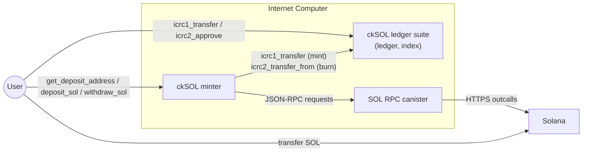
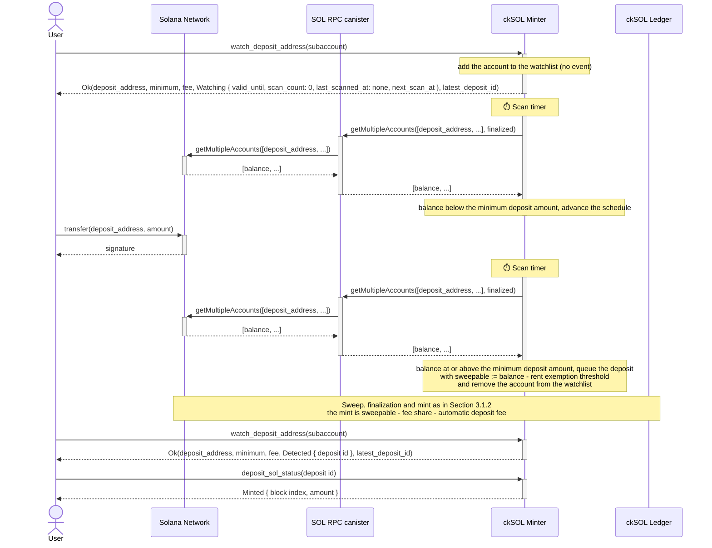
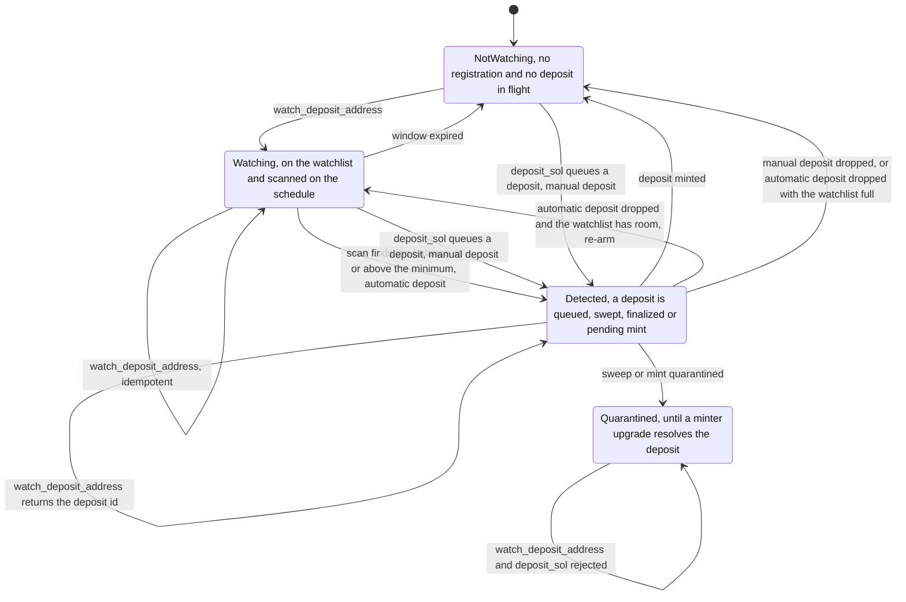
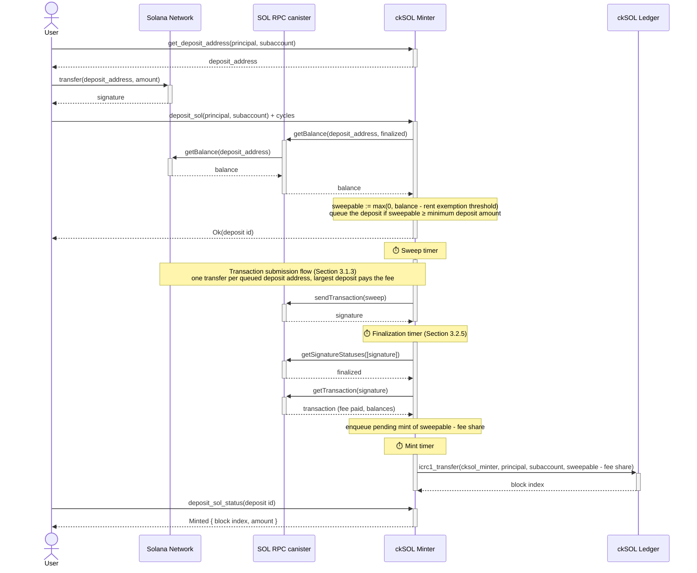
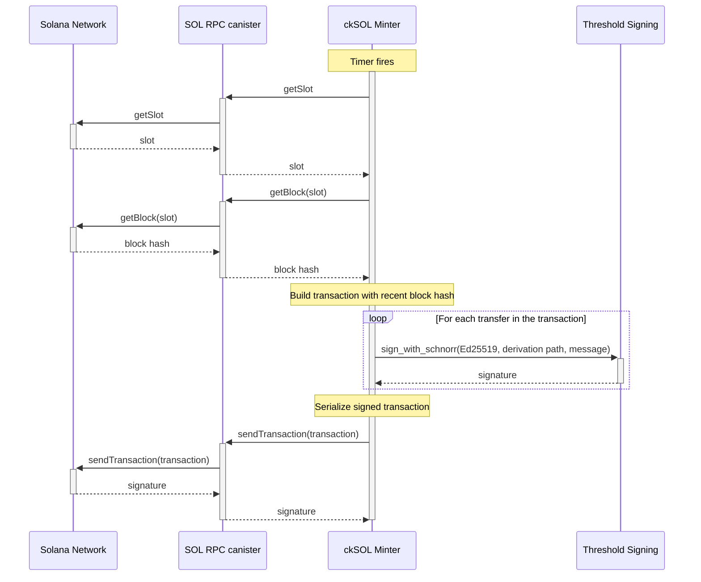
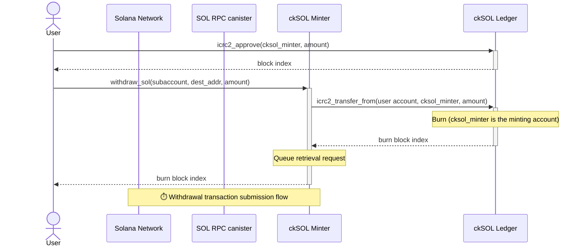
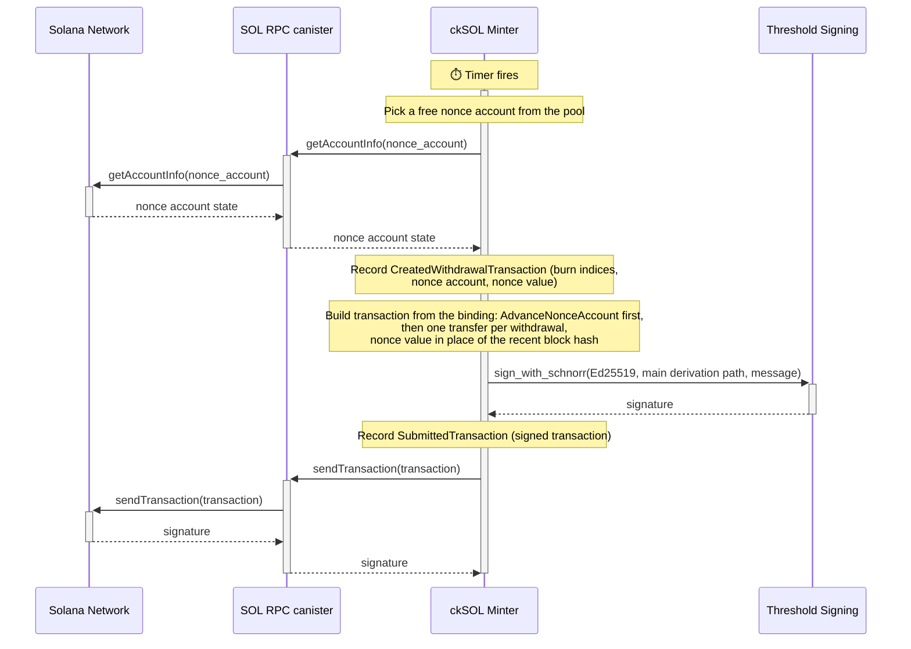
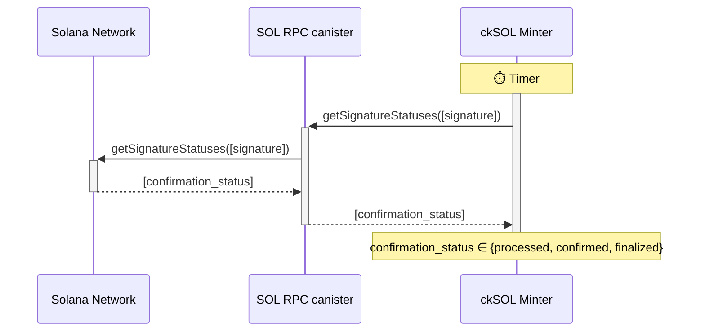
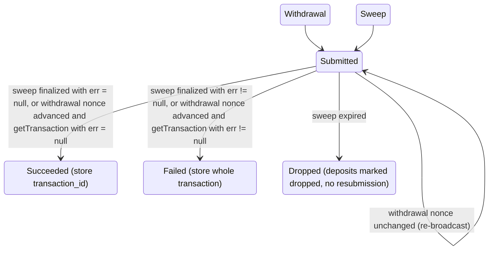

# Chain-Key SOL (ckSOL) Design

- [1. High-Level Goal](#1-high-level-goal)
- [2. Overview](#2-overview)
- [3. Technical Details](#3-technical-details)
  - [3.1. Converting SOL to ckSOL](#31-converting-sol-to-cksol)
    - [3.1.1. Automatic Flow](#311-automatic-flow)
    - [3.1.2. Manual Flow](#312-manual-flow)
    - [3.1.3. Transaction Submission](#313-transaction-submission)
  - [3.2. Converting ckSOL to SOL](#32-converting-cksol-to-sol)
    - [3.2.1. Durable Nonce Accounts](#321-durable-nonce-accounts)
    - [3.2.2. Nonce Account Setup](#322-nonce-account-setup)
    - [3.2.3. Reinstallation](#323-reinstallation)
    - [3.2.4. Submitting Withdrawal Requests](#324-submitting-withdrawal-requests)
    - [3.2.5. Finalization and Re-broadcast](#325-finalization-and-re-broadcast)
  - [3.3. Fees & Minimum Swap Amounts](#33-fees--minimum-swap-amounts)
    - [3.3.1. ckSOL Ledger Fees](#331-cksol-ledger-fees)
    - [3.3.2. ckSOL Minter Fees](#332-cksol-minter-fees)
    - [3.3.3. Minimum Swap Amounts](#333-minimum-swap-amounts)
    - [3.3.4. Parameter Constraints](#334-parameter-constraints)
  - [3.4. OFAC Checks](#34-ofac-checks)
  - [3.5. Events](#35-events)
  - [3.6. API](#36-api)

## 1. High-Level Goal

The goal is to support a new ICRC-2 (and ICRC-3) compliant token on the IC, called chain-key Solana (**ckSOL**), that is backed 1:1 by SOL, the primary token on the Solana blockchain. Users should be able to convert their SOL tokens to ckSOL and vice versa.

## 2. Overview

The ckSOL functionality is introduced with a new canister (**ckSOL minter**) together with an instance of the ICRC ledger suite, in particular a ledger canister (**ckSOL ledger**) and an index canister. Archiving is deliberately disabled, by setting the archive trigger threshold beyond any reachable block count, so the suite spawns no archive canisters. The ckSOL minter *default account* is the *minting account* of the ckSOL ledger.

The ckSOL minter is the canister responsible for managing deposited SOL and minting/burning ckSOL. Concretely, it provides the following functionality:

- **Mint**: If a user transfers SOL to a specific account under the ckSOL minter's control, the ckSOL minter can instruct the ckSOL ledger to mint ckSOL for the user, owned by a given ICRC account (principal ID-subaccount pair).
- **Burn**: After granting the ckSOL minter access to some of the user's funds, the user can request a withdrawal of SOL to be sent to a user-provided destination address. The funds are sent out after instructing the ckSOL ledger to burn the requested amount of ckSOL tokens.

Both operations, as well as the transfer of ckSOL, incur a fee as specified in [Section 3.3](#33-fees--minimum-swap-amounts).

The general model is that the ckSOL minter needs to receive SOL *before* it mints ckSOL, and it burns ckSOL *before* it transfers SOL back to the users, in order to ensure that the total supply of ckSOL is always upper bounded by the amount of SOL held by the ckSOL minter.

In addition to performing the mint and burn transactions, the ckSOL ledger is responsible for keeping account balances and for transferring ckSOL between accounts. As mentioned before, the ckSOL ledger must be ICRC-1, ICRC-2, and ICRC-3 compliant. As the ckSOL ledger is a standard ICRC ledger, the following sections are concerned with the design of the ckSOL minter.

The following figure summarizes how the user, the ckSOL minter, the ckSOL ledger, and the SOL RPC canister interact. Each interaction is described in detail in [Section 3](#3-technical-details).



## 3. Technical Details

The ckSOL minter interacts with the Solana blockchain via the [SOL RPC canister](https://github.com/dfinity/sol-rpc-canister). The ckSOL minter uses the following subset of endpoints:

- [getAccountInfo](https://solana.com/docs/rpc/http/getaccountinfo): Returns the account information for the given address. This function is used to read the state of a durable nonce account before building a withdrawal transaction and to determine whether an in-flight withdrawal transaction has landed (see [Section 3.2.1](#321-durable-nonce-accounts) and [Section 3.2.5](#325-finalization-and-re-broadcast)).
- [getBalance](https://solana.com/docs/rpc/http/getbalance): Returns the balance of the given address. This function is used by `deposit_sol` to read the balance of a deposit address at the `finalized` commitment level and determine the sweepable amount.
- [getBlock](https://solana.com/docs/rpc/http/getblock): Returns the block for the given slot. This function is used to get a recent block hash, which is contained in the response. Note that `transactionDetails` is set to `null` in the request. As a result, signatures and transactions are not returned.
- [getMultipleAccounts](https://solana.com/docs/rpc/http/getmultipleaccounts): Returns the account information, in particular the balance, of up to 100 addresses in a single call. This function is used by the automatic deposit flow of [Section 3.1.1](#311-automatic-flow) to read the balances of the watched deposit addresses at the `finalized` commitment level. It is not yet offered as a typed method by the SOL RPC canister; adding it, with the response context stripped so that the providers' responses can reach consensus, is a prerequisite of that flow.
- [getSignatureStatuses](https://solana.com/docs/rpc/http/getsignaturestatuses): Returns the status of each transaction specified through its identifier, i.e., the first signature in the transaction. This function is used to learn whether a sweep transaction has been finalized or has expired, as described in [Section 3.2.5](#325-finalization-and-re-broadcast). Withdrawal transactions are not checked with it.
- [getSlot](https://solana.com/docs/rpc/http/getslot): Returns the current slot. Since the slot number changes rapidly, the SOL RPC canister merely obtains a rounded and therefore slightly outdated slot number. The slot number is required to obtain a recent block hash using `getBlock`, whose block height is persisted with the transaction and later compared against the current block height to check if an unconfirmed transaction has expired.
- [getTransaction](https://solana.com/docs/rpc/http/gettransaction): Returns the whole transaction for the given signature. This function is used to read the outcome of a finalized sweep transaction and of a landed withdrawal transaction.
- [sendTransaction](https://solana.com/docs/rpc/http/sendtransaction): Sends out the provided transaction. It requires the execution of the functions `getSlot` and `getBlock` to obtain a recent block hash, which must be part of the transaction, except for withdrawal transactions, which carry a durable nonce instead (see [Section 3.2.1](#321-durable-nonce-accounts)).

### 3.1. Converting SOL to ckSOL

The process of converting SOL to ckSOL should be as simple as possible for the user, or more generally for any frontend that offers this functionality. It should further be possible to convert SOL held on centralized exchanges straight to ckSOL. While SOL transfers can bear a memo, which would make it possible to use the same destination address, controlled by the ckSOL minter, for all conversions, most popular centralized exchanges do not offer the option to specify a memo, making a direct transfer to a single address infeasible, as the ckSOL minter could not determine the ICRC account (principal ID plus subaccount) that should be credited for received funds.

The chosen approach is to derive a **deposit address** for a given ICRC account: The user calls the endpoint `get_deposit_address` with a principal ID and subaccount as parameters on the ckSOL minter and receives a derived SOL address in return. Note that the SOL address is derived deterministically, i.e., always the same address is returned for the same principal ID and subaccount. Since it is a deterministic function, other pieces of software, such as frontends or other canisters, can derive deposit addresses themselves instead of querying the ckSOL minter.

Concretely, the deposit address is derived from the ckSOL minter's master public key with the user's account (principal ID and subaccount) used [as the derivation path](https://github.com/dfinity/ic/blob/215615d2d08f2679126fbe074bbff2e1bf3064dc/rs/bitcoin/ckbtc/minter/src/address.rs#L102), i.e., effectively the same mechanism as for [ckBTC](https://learn.internetcomputer.org/hc/en-us/articles/44598021228564-Chain-key-Bitcoin) is used to generate a user-specific address. The user can then transfer the desired amount to this address. The minter's own main address, in contrast, is the master public key itself (the empty derivation path): since every deposit address is derived under a non-empty, schema-tagged path, the main address can never coincide with a deposit address, which would otherwise let the swept funds held by the minter be mistaken for a user deposit. Two deposit flows are described next. In the manual flow, which is the one the ckSOL minter offers since its launch, the caller asks the minter to read the balance of the deposit address and pays for that read in cycles. In the automatic flow, a post-launch addition, the caller registers the deposit address for free, the minter reads its balance on a timer for about a day, and a fixed fee in SOL is deducted from the minted amount. Both flows credit a deposit the same way, by sweeping the deposit address to the minter's main account, so the automatic flow is described first in terms of how it differs from the manual one, and the manual flow then describes the sweep that both share.

#### 3.1.1. Automatic Flow

The automatic flow lets a user obtain ckSOL without calling the ckSOL minter after the transfer, which is the situation of a deposit from a centralized exchange: the user withdraws SOL from the exchange to the deposit address, and nothing else happens on the user's side. It is built on top of the manual flow of [Section 3.1.2](#312-manual-flow) rather than a separate crediting path: the ckSOL minter reads the balances of registered deposit addresses on a timer and, when a balance reaches the minimum deposit amount, queues exactly the sweep that `deposit_sol` would have queued. From that point on, the deposit is swept, finalized, settled and minted as described in [Section 3.1.2](#312-manual-flow), so a deposit address is only ever credited by one mechanism, the sweep, whichever way its balance was noticed.

Compared to the manual flow, the automatic flow differs in who triggers the balance read (a timer instead of the caller), in what the caller pays (nothing at call time, and a fixed fee in SOL deducted from the minted amount instead of cycles) and in the detection latency (a schedule of scans spread over about a day instead of an immediate read).

The flow is depicted in the following figure.



**Registration.** The flow is triggered by calling `watch_deposit_address` with an optional subaccount. The account to credit is the caller's principal with that subaccount. Unlike `deposit_sol`, the endpoint does not accept another owner: the call is free and the owner pays the fee, so letting a caller name another owner would allow anyone to force sweeps of, and fees on, a victim's deposit address. The caller must be neither the anonymous principal nor the ckSOL minter itself, for the reason given in [Section 3.1.2](#312-manual-flow). The call derives the deposit address, adds the account to the *watchlist* for a window of about 24 hours (see the schedule below), and returns the deposit address, the current minimum deposit amount and automatic deposit fee, the *status* of the account and the id of the latest deposit queued for the account, if any. As in the ckETH minter, nothing is frozen at registration: the two amounts are quotes of the parameters in force at the time of the call, whatever the status, and the parameters in force when a scan detects the deposit are the ones that apply, as described under detection below. An upgrade changing them during the window therefore affects every registration that has not been detected yet, and none that has.

The states of an account in the automatic flow, and the transitions between them, are shown in the following figure. `Detected` covers every stage of a deposit in flight, from queued to pending mint, which [Section 3.1.2](#312-manual-flow) details.



The status is `Watching`, with the end of the window, the number of scans so far, the time of the last scan and the time the next scan is *due*, which is not a promise of when it runs: a scan lands on the next tick at or after that time, so the time lies in the past until then, and a client reads a next scan time in the past as a scan still pending, as long as the account is on the watchlist, and `Detected`, with the *deposit id* that identifies a sweep of the account for its whole life, as defined in [Section 3.1.2](#312-manual-flow), once a deposit is in flight for the account. As in the ckETH minter, there is no separate status endpoint: calling `watch_deposit_address` again is how a client follows a registration. Registering an account that is already watched is idempotent and returns the stored registration without extending its window; an account with a deposit in flight is not registered, since the sweep flow already owns its address, and the call returns `Detected`; and an account whose latest deposit is minted or dropped is registered anew, so that the next deposit to the same address needs nothing but another call. The id of the latest deposit is returned in every case, so that a client coming back hours after a detection can follow the deposit with `deposit_sol_status`. An account whose automatically detected deposit was dropped is reported as `Watching` again when the re-arm described below has put it back on the watchlist.

The call does not contact the SOL RPC canister and requires no cycles. It is rejected when the latest deposit of the account is quarantined (`Quarantined`, as for `deposit_sol`), when the call would create a new registration while the watchlist is full of live entries (`TooManyWatchedAddresses`, with the id of the latest deposit of the account, if any; an account already watched or with a deposit in flight needs no slot and gets its status), and with `TemporarilyUnavailable` when the minter's public key is not yet known or when the automatic deposit fee has not been configured. A `deposit_sol` call in progress for the same account does not prevent the registration: if that call queues a deposit, the registration is removed again, and otherwise it stays, which is what the caller wanted in either case. A registration is not recorded in the event log, see [Section 3.5](#35-events).

The manual flow remains available while an address is watched: a `deposit_sol` call that queues a deposit removes the account from the watchlist, and since its caller paid in cycles, no SOL fee is deducted from that deposit.

**Watchlist and schedule.** The watchlist holds at most `MAX_WATCHED_ADDRESSES = 1,000` live entries, each with the account, its deposit address, the end of its window, the start of its schedule and its scan progress, i.e. the number of scans and the time of the last one. A timer runs every minute, under the same kind of guard as the other timers of the ckSOL minter, so that a tick which finds the previous one still waiting for its calls is skipped rather than run concurrently, and scans the entries that are *due*. The schedule of an entry is a fixed list of *slots*, measured from the start of its schedule and adapted from the ckETH minter: at 0, 60, 120, 240, 360 and 600 seconds, then every 300 seconds up to 1,800 seconds, i.e. ten slots in the first 30 minutes, followed by hourly slots from 1.5 hours up to 23.5 hours, 33 slots in all. An entry is due at its first slot if it has not been scanned yet, and otherwise once the first slot after its last scan has passed; a scan lands on the next tick at or after that slot. Since the slots are fixed, a scan that comes late, because a tick is skipped, a call fails or the ckSOL minter is stopped for an upgrade, does not shift the slots that follow: the entry is scanned once it is due, and its next slot is the first one after that scan, so slots that passed in the meantime are not made up and the number of scans may fall short of the number of slots. Nothing is lost by that, since a balance scan is idempotent: one read after an outage tells as much as the reads it replaces. The window of a registration is fixed when the call returns, at 24 hours after registration, as in the ckETH minter; the last slot lies half an hour before its end, and a slot after the end of the window is never scanned, so the status then reports no next scan. The due time reported by the status is the next slot, so it does not move between two reads. The window end is the one boundary clients and the re-arm rely on: a transfer finalized after the last scan is not noticed until the account is registered again, which the next `watch_deposit_address` call does once the window has passed, starting a new window and reporting its first slot.

The tick and the first gaps are coarser than the 30 second cadence of the ckETH minter, deliberately. Solana's 400 ms block time plays no role in a balance poll: a transfer is visible at the `finalized` commitment level about 13 seconds after it lands, and a consensus round of HTTPS outcalls through the SOL RPC canister takes several seconds, so a detection latency of one to two minutes is close to the floor of what the stack delivers, and a withdrawal from an exchange takes minutes anyway. The tick rate is also the dominant term of the cost bound derived below. The schedule is measured in wall-clock time, since the ckSOL minter does not track the Solana block height continuously, unlike the ckETH minter, which measures elapsed blocks.

Entries leave the watchlist when a scan queues a deposit, when a `deposit_sol` call queues a deposit, or when their window has expired; expired entries are evicted lazily, on registration and at each tick, and do not count against the capacity. A minted deposit does not re-arm the watch: the next deposit to the same address needs a new registration, which is free. A dropped sweep does: when the sweep of an automatically detected deposit fails or expires (see [Section 3.1.2](#312-manual-flow)), the account is registered again, for a fresh window and schedule starting at the drop, provided the watchlist has room, so that the funds still sitting on the deposit address are swept again without the user's intervention. The re-arm counts against the capacity like a registration, since the slot was released at detection and may have been taken since; when the watchlist is full of live entries, the deposit stays dropped and its funds wait for the user, as for a manual deposit, so that the capacity bound and everything derived from it keep holding. The fresh schedule starts with the burst, since the scan progress left the watchlist with the detection and the funds are known to be there, which makes the burst the right cadence; the extra scans only ever follow a detection, which requires real funds on the address, so they are not available to an adversary for free. The re-arm is not bounded by the original window, so a sweep that keeps failing is detected and re-armed again until it lands, at the ckSOL minter's expense; this is accepted because a dropped sweep is an infrastructure failure that is alerted on and that no user can bring about, and because a bound at the original window would only have capped such a chain at a day while costing every queued deposit its window end. An account on the watchlist never has a deposit in flight.

**Detection.** A tick collects the due entries, reads the balances of their deposit addresses with `getMultipleAccounts` at the `finalized` commitment level, up to 100 addresses per call and at most `MAX_CONCURRENT_RPC_CALLS` calls concurrently, so that one tick covers the full watchlist, and treats a missing account as a zero balance. Deposit addresses are plain system accounts without data, so the request asks for no account data and the response is about 150 bytes per address; the cycles attached to a call are sized by the number of addresses it carries. A call that fails leaves the progress of its entries untouched, and they are read again at the next tick.

An address whose balance is at or above the minimum deposit amount in force at that moment is queued exactly as `deposit_sol` queues it: the sweepable amount is the balance minus the rent exemption threshold, the deposit gets the next deposit id, and the `QueuedDeposit` event is recorded, carrying in addition the automatic deposit fee in force at that moment. The recorded fee is the one deducted when the deposit is credited, so a fee change by upgrade after detection does not affect it: a deposit that an upgrade finds queued, swept or finalized is credited afterwards with the fee restored from its `QueuedDeposit`, and a deposit already credited has its mint amount recorded in `CreditedSweep`, as for any sweep; the constraint of [Section 3.3.4](#334-parameter-constraints) is checked against the current parameters at every init and upgrade, so a deposit detected under them always mints a positive amount. The trust model is that of the manual flow: the balance is read at `finalized` with the 3-out-of-4 provider consensus and becomes the planned sweep amount, and a wrong balance cannot cause an over-mint, since ckSOL is minted only after the sweep has been finalized and settled against the finalized transaction. This differs from the ckETH minter, where the scanned balance is only a trigger. An address whose balance is below the minimum, including one that holds only the rent exemption threshold left by a previous sweep, advances to its next scan.

**Concurrency.** Scan ticks never overlap: the scan runs under the same single-round guard as the sweep and finalization timers, so a tick that fires while the previous one is still waiting for its calls returns immediately, and the bound of `MAX_CONCURRENT_RPC_CALLS` in-flight calls holds. The scan and `deposit_sol`, however, may read the balance of the same address at the same time, since both span an inter-canister call, and neither path may assert on the other. Before its call, the scan skips the accounts for which a `deposit_sol` call is in progress; after the call, it checks each entry again and skips it silently if it is no longer watched under the same registration, if its window has passed in the meantime, or if the account has a deposit in flight; the window end thus holds even for a read that started just before it, at the price of discarding that one read. Symmetrically, `deposit_sol` records the id of the latest deposit of the account before its `getBalance` call and compares it after: if it changed, a scan queued a deposit in the meantime, so the call returns that id, whatever state the deposit has reached since, and charges only the RPC call. Comparing the id rather than checking whether a deposit is in flight also covers the theoretical case of the scan's deposit being minted or dropped before the callback runs, which would otherwise free the account for a second deposit from a stale balance. An account registered while a tick is running is scanned at the next tick. Since the watchlist is heap state, an upgrade in the middle of a tick loses nothing but that tick: the snapshot taken before the upgrade carries the watchlist, and the scan is redone afterwards.

**Fee.** An automatically detected deposit pays the **automatic deposit fee** of [Section 3.3.2](#332-cksol-minter-fees) in SOL: the amount minted is the sweepable amount minus the deposit's share of the sweep transaction fee minus the automatic deposit fee, while the main account receives the sweepable amount minus that fee share, as for any sweep. The main account therefore holds the automatic deposit fee on top of the ckSOL minted for the deposit. The ckSOL minter keeps the sum of the fees collected this way as a separate figure, reported by `get_minter_info`, in the metrics and on the dashboard; the main account balance keeps counting it. What to do with this surplus, e.g. converting it into cycles, is out of scope. Minting the fee to a minter-owned account on the ledger, as the ckETH minter does, would keep the ckSOL supply equal to the SOL backing and make the revenue auditable on the ledger; it is not chosen here, so that the fee can be used without a burn.

**Cost bounds.** Since registration is free, the cost of the automatic flow to the ckSOL minter must be bounded independently of the callers' behaviour. The bounds are the capacity of the watchlist, the window and the schedule, the chunk size of 100 addresses per call and, above all, the tick: every minute in which at least one entry is due costs at least one call. In the worst case, with the watchlist kept full by an adversary, a day costs at most 1,440 ticks plus 1,000 × 33 / 100 chunk calls, about 1,770 calls, i.e. at most 8T cycles (about 11.5 USD at 1T cycles = 1.44 USD) if every call were a full 100-address call, and about 4 to 5T cycles in practice, since most calls are small. This is the bound for registrations that never receive funds. The caller-independent hard bound is a full tick every minute, `MAX_CONCURRENT_RPC_CALLS` × 1,440 = 14,400 calls per day, about 65T cycles. It is reached in two ways. An adversary can churn the watchlist with funded addresses, having 1,000 deposits detected and their slots refilled every minute, but every detection needs at least the minimum deposit amount on chain and pays the automatic deposit fee, so that attack pays the ckSOL minter far more than it costs it; the same holds for the re-arms, which add scans only after a detection. And while the SOL RPC canister fails persistently, the entries keep their progress and every tick retries; that situation is not under an adversary's control and affects every timer of the ckSOL minter alike, so no retry budget is added for it. An adversary needs only about 60 addresses registered a minute apart to keep every tick busy, for about 3.3T cycles per day, and can repeat this every day for free. The honest case costs about the same once a few dozen addresses are watched, since the tick dominates: with N addresses in the hourly tail, a tick runs roughly min(60, N) times per hour. Should this standing cost prove too high, the knob is to coalesce ticks, scanning only when enough entries are due or when the oldest due entry has waited for a grace period, at the price of latency. For comparison, reading each address with `getBalance` would cost 1,000 × 33 × 2.3B = 76T cycles per day under the same attack, which is why `getMultipleAccounts` is a prerequisite of this flow rather than an optimisation. The scan adds at most `MAX_CONCURRENT_RPC_CALLS` in-flight calls to the SOL RPC canister to those of the other timers; each of them is fanned out by that canister into one HTTPS outcall per provider of the consensus round.

The event log is not a vector: a registration records nothing, so an adversary cannot grow the log for free, and the only events the automatic flow adds to the ones a detected deposit shares with a manual one (the submission, settlement, mint and possible failure or expiry of its sweep) are the `QueuedDeposit` of the detected deposit, which requires at least the minimum deposit amount on chain, and the watchlist snapshot taken once per upgrade, whose size is bounded by the capacity, see [Section 3.5](#35-events). A full watchlist blocks honest registrations, and the manual flow remains available in that case; since filling it is free, the number of live registrations is exposed as a metric so that an alert can fire before the capacity is reached.

**Compatibility.** The automatic flow is added to a ckSOL minter that is deployed on mainnet, so it only extends the interface and the state: one new endpoint; a new optional `automatic_deposit_fee` field in the init and upgrade arguments and in `get_minter_info`, together with the collected fees; an optional field of the `QueuedDeposit` event carrying the fee of an automatic deposit, absent for manual deposits; a new snapshot event recorded by a new `pre_upgrade` hook; and a new timer. The types of `deposit_sol` and `deposit_sol_status` and the stable memory layout are unchanged, and an event log written before the upgrade replays unchanged.

#### 3.1.2. Manual Flow

A user first obtains their deposit address with `get_deposit_address` and transfers SOL to it. The user then asks the ckSOL minter to *sweep* that address. The user does not identify individual Solana transactions: the ckSOL minter reads the balance of the deposit address, moves it to its main account, and mints ckSOL once that sweep is finalized. As a consequence, several transfers that are each below the minimum deposit amount are credited together once their sum exceeds it, and deposits from centralized exchanges, which typically do not show the transaction signature to the user, need nothing but the deposit address.

The manual flow is depicted in the following figure. The sweep reuses the transaction submission flow and the finalization flow described in [Section 3.1.3](#313-transaction-submission) and [Section 3.2.5](#325-finalization-and-re-broadcast).



**Request.** The flow is triggered by calling `deposit_sol` with the user's account (principal ID and subaccount) as parameters. The principal may differ from the caller's, so that a frontend or another canister can pay for a user's deposit, but it must be neither the anonymous principal nor the ckSOL minter's own principal, whose default account is the minting account of the ckSOL ledger, to which nothing can be minted, and which has no reason to deposit to itself. The endpoint requires cycles to be attached; the required amount is exposed as `deposit_sol_required_cycles` in `get_minter_info` and, as explained below, most of it is refunded. At most one deposit per account can be in flight: if a deposit for the given account is queued, swept, or finalized but not yet minted, the call returns the id of that deposit and refunds all attached cycles without contacting the SOL RPC canister, so that a retried call is idempotent. Only a deposit that is minted or dropped allows a new sweep of the same account. If the latest deposit of the account is quarantined, the call is rejected with an error carrying the id of the quarantined deposit, since the outcome of its sweep did not match the plan the minter submitted and the deposit could not be credited safely, and the account remains rejected until a minter upgrade resolves the quarantined deposit; a new deposit has to use a different subaccount. The account is reserved before the first inter-canister call, so that concurrent calls for the same account cannot both pass this check, and the reservation is released on every error path. The reservation does not cover the scan of the automatic flow, which may read the same address concurrently; the call therefore records the id of the latest deposit of the account before the balance read and compares it afterwards: if a scan queued a deposit in the meantime, the call returns its id and charges only the RPC call, as described in [Section 3.1.1](#311-automatic-flow). A scan queues a deposit through the same steps as this endpoint, from the balance check onwards.

**Balance check.** The ckSOL minter calls the `getBalance` endpoint of the SOL RPC canister for the deposit address at the `finalized` commitment level. No `minContextSlot` is set: the SOL RPC canister returns no context slot, so the slot at which a previous sweep of the address was finalized cannot be learned, and the 3-out-of-4 provider consensus is part of the trust model. A balance that a lagging provider reports too high cannot cause an over-mint either, since ckSOL is minted only once the sweep transaction has been finalized and the amount credited is read from that transaction, and a sweep built on an inflated balance is not a valid transaction. The *sweepable amount* is the balance minus the **rent exemption threshold** (890,880 lamports for an account without data), or zero if the balance does not exceed the threshold. This threshold is deliberately left on the deposit address: Solana rejects any transaction that would leave an account with a nonzero balance below the threshold, so sweeping the whole balance would fail as soon as a small transfer arrived between the balance check and the execution of the sweep. Keeping the threshold on the address makes the sweep independent of concurrent transfers. The threshold is paid once per deposit address, since later sweeps find it already in place.

If the balance is below the **minimum deposit amount** defined in [Section 3.3.3](#333-minimum-swap-amounts), the call fails with `ValueTooSmall`, reporting the balance and the minimum, so that the user knows how much to top up. The minimum applies to the balance of the deposit address and therefore includes the rent exemption threshold: a deposit of exactly the minimum deposit amount is accepted. Only the cost of the `getBalance` call is charged in this case. Otherwise the deposit is recorded as *queued* with the account, the deposit address, and the sweepable amount, and the call returns a *deposit id*, a sequence number assigned by the ckSOL minter that identifies this sweep of the account for the rest of its life, in the same way as a withdrawal is identified by its burn index. The cycles charged are the cost of the `getBalance` call plus the **deposit_sol fee**, which covers the threshold signature of the sweep and the deposit's share of the RPC calls made by the sweep and finalization timers, as detailed in [Section 3.3.2](#332-cksol-minter-fees). The remaining cycles are refunded.

**Sweep.** A timer, running every minute, takes the queued deposits in batches of at most 10 and submits one Solana transaction per batch, following the transaction submission flow of [Section 3.1.3](#313-transaction-submission); a single round covers at most 100 deposits and reschedules itself when more are queued. Each deposit address signs a transfer of its sweepable amount to the main account of the ckSOL minter. The deposit address with the largest sweepable amount is the fee payer; it is listed first in the transaction and its transfer is reduced by the transaction fee of `5000 * k` lamports for `k` signatures. Since the minimum deposit amount is larger than the fee of a full batch (see [Section 3.3.4](#334-parameter-constraints)), the fee payer always has enough funds, and every deposit address is left with the rent exemption threshold plus whatever arrived after the balance check. The deposits are recorded as *swept* together with the transaction signature. No ckSOL is minted yet.

**Finalization.** The sweep transaction is monitored like any other transaction, as described in [Section 3.2.5](#325-finalization-and-re-broadcast). Once the transaction is finalized successfully, the deposits it contains are recorded as *finalized*: the SOL has moved to the main account, and the remaining steps only account for it. From this point on, `deposit_sol_status` reports `Finalized` with the sweep signature until the mint lands.

The ckSOL minter then fetches the transaction with `getTransaction` and *settles* it against the plan the sweep was submitted with. Nothing is inferred from the outcome: the executed message must be exactly the planned one, every deposit address must have decreased by exactly its transfer, plus the fee reported in the metadata for the fee payer, and must end with at least the rent exemption threshold, since a transfer that arrived after the balance check legitimately leaves more, and the main account must have received exactly the planned amount, the sum of the sweepable amounts minus the assumed fee of `5000 * k` lamports. The reported fee may be lower than assumed, in which case the difference stays on the fee payer's address, but it may not be higher. If the `getTransaction` call fails or its result cannot be read, the deposits stay finalized and the fetch is retried on the next run of the finalization timer. If the result is readable but contradicts the plan, the ckSOL minter's model of the transaction is wrong, so nothing is minted: the deposits are *quarantined*, reusing the existing mechanism that prevents double minting, are reported on the dashboard together with the sweep signature, and the number of quarantined deposits is exposed as a metric. They are not processed further without a minter upgrade.

Once settled, the balance of the main account is increased by the amount received. The transaction fee is borne by the batch: for each deposit in the transaction, the ckSOL minter enqueues a *pending mint* of the sweepable amount minus the deposit's share of the fee, `ceil(fee / k)`, to the user's account. Rounding the share up guarantees that the total of the pending mints is never larger than the amount received on the main account, so the ckSOL supply is always covered. For a deposit queued by the automatic flow, the pending mint is further reduced by the automatic deposit fee recorded with the deposit (see [Section 3.1.1](#311-automatic-flow)), and the fee is added to the collected fees; the constraint of [Section 3.3.4](#334-parameter-constraints) guarantees that the pending mint stays positive. The amount to mint of each deposit is recorded in the event together with the amount received, so that replaying the event log restores the pending mints as they were enqueued rather than recomputing them.

Pending mints are processed on a timer: each one is a single `icrc1_transfer` call whose memo contains the sweep signature and the deposit id. The `created_at_time` of the transfer is fixed when the pending mint is enqueued and stored with it, so that every retry sends exactly the same arguments and the ckSOL ledger deduplicates it: a mint whose ledger call fails stays in the queue and is retried on the next run, and a `Duplicate` reply from the ledger is recorded as a successful mint with the block index it carries. Since the ledger only deduplicates transfers within its 24-hour window, a pending mint older than that is quarantined instead of retried. The sweep transaction itself is never resubmitted once it is finalized.

A user can follow the progress with `deposit_sol_status`, which takes a deposit id and reports its status: `Queued` with the sweepable amount, `Swept` and `Finalized` with the sweep signature, `Minted` with the ledger block index and the minted amount, and `Dropped` and `Quarantined` with the sweep signature when there is one. Since every sweep has its own id, a `Minted` status stays observable after the account has been swept again; the mint itself is also visible on the ckSOL ledger, whose memo links it to the sweep signature and the deposit id.

Two failure cases exist before the transaction is finalized, and in neither is the transaction resubmitted by the ckSOL minter:

1. The transaction is finalized with an error. The funds are still on the deposit addresses, minus the fee paid by the fee payer. This should never happen with the invariants above, so it is reported as an error in the logs and in the metrics.
2. The transaction expires, i.e., its blockhash is no longer valid and it has no on-chain status. The sweep is dropped and *not* resubmitted with a new blockhash. Expiry is determined against the last valid block height persisted with the transaction, as described in [Section 3.2.5](#325-finalization-and-re-broadcast), never by counting slots; otherwise a transaction declared expired could still land, and the funds would reach the main account without being credited. Expiry only establishes that the transaction can no longer land, not that it never did, so the status check searches the available transaction history rather than the recent status cache, which holds about two minutes. Otherwise a sweep that landed while the checks had a longer gap, caused by the timer interval, by rounds skipped on RPC errors, or by an upgrade, would be reported as having no status and dropped after it had moved the funds.

In both cases the queued deposits are marked as *dropped*, and the number of dropped deposits is exposed as a metric. Since nothing was minted, no ckSOL is owed, and the user calls `deposit_sol` again to queue a new sweep of the balance that is still on the deposit address; a deposit that was queued by the automatic flow is instead put back on the watchlist for a fresh window, when the watchlist has room, as described in [Section 3.1.1](#311-automatic-flow). For a failed transaction that balance is certain, because the transfers never executed. For an expired one it rests on the sweep never having landed, which the status check above establishes but cannot prove: were a landed sweep dropped regardless, its funds would sit in the main account with nobody credited for them, and returning them would take an upgrade. In other words, for a manual deposit the retry is triggered and paid for by the caller, while for an automatic deposit the re-arm leads to a new balance read and, if the funds are still there, a new sweep without another call, at the ckSOL minter's expense. In the first case Solana charges the fee even though the transaction failed, so the fee payer of that batch loses up to `5000 * k` lamports and its deposit address can fall just below the minimum deposit amount, in which case the next `deposit_sol` call reports the balance as too small until the user tops it up. This loss is accepted rather than reimbursed: the case should never occur, which is why it is alerted on, and a reimbursement flow would add a second path that moves funds without a deposit behind it.

**Example.** The following example uses the parameters of [Section 3.3](#33-fees--minimum-swap-amounts), a price of 1 SOL = 100 USD, and 1T cycles = 1 XDR = 1.44 USD. Alice deposits 1 SOL and Bob deposits 0.05 SOL, each to their own deposit address, which was empty before, and both deposits are swept in the same transaction.

| Stage | Alice | Bob | Paid by | Notes |
| --- | --- | --- | --- | --- |
| 1. Transfer to the deposit address | 1,000,000,000 lamports (1 SOL) | 50,000,000 lamports (0.05 SOL) | User's wallet | The Solana fee of 5,000 lamports for this transfer is paid by the sender on top of the amount and is not visible to the ckSOL minter. |
| 2. `deposit_sol` with 1T cycles attached | charged 47.31B cycles (0.068 USD) | charged 47.31B cycles (0.068 USD) | Caller, in cycles | 2.31B cycles for `getBalance` plus the deposit_sol fee of 45B cycles. 952.69B cycles are refunded. |
| 3. Sweepable amount | 999,109,120 lamports | 49,109,120 lamports | | Balance minus the rent exemption threshold of 890,880 lamports (0.089 USD), which stays on the deposit address. |
| 4. Sweep transaction fee | 10,000 lamports paid on-chain | 0 | Fee payer (Alice) | Two signatures at 5,000 lamports each. Alice transfers 999,099,120 lamports, Bob transfers 49,109,120 lamports. Both deposit addresses end at 890,880 lamports; the main account receives 1,048,208,240 lamports. |
| 5. Mint | 999,104,120 lamports (0.99910412 ckSOL) | 49,104,120 lamports (0.04910412 ckSOL) | | Sweepable amount minus the shortfall share of `ceil(10,000 / 2) = 5,000` lamports, the shortfall being the 1,048,218,240 lamports swept minus the 1,048,208,240 received. The total minted equals the amount received on the main account. |

For Alice, converting 1 SOL to ckSOL costs 895,880 lamports (0.0896 USD) on Solana, of which 890,880 lamports remain on her deposit address and are not charged again for her next deposit, plus 47.31B cycles (0.068 USD). Bob pays the same, so smaller deposits pay a proportionally larger share; a first deposit of exactly the minimum deposit amount of 0.02 SOL would be credited 19,104,120 lamports, i.e., 95.5% of the amount deposited. Had Alice used the automatic flow instead, she would have attached no cycles and been credited 997,104,120 lamports: the same sweepable amount and fee share, minus the automatic deposit fee of 2,000,000 lamports (0.2 USD) that stays on the main account.

If Bob then withdraws everything, he first approves the ckSOL minter, which costs the ledger transfer fee of 500 lamports, and then withdraws the remaining 49,103,620 lamports. After the withdrawal fee of 1,000,000 lamports, the destination address receives 48,103,620 lamports (0.04810362 SOL). The whole round trip from 0.05 SOL to 0.04810362 SOL costs 1,896,380 lamports (0.19 USD), of which 890,880 lamports are still under the control of the ckSOL minter on Bob's deposit address, plus the cycles attached to `deposit_sol`.

#### 3.1.3. Transaction Submission

This section describes the flow that submits a Solana transaction carrying a recent block hash, which the sweeps of [Section 3.1.2](#312-manual-flow) follow. Withdrawals do not: they carry the value of a durable nonce account instead of a recent block hash, as described in [Section 3.2.4](#324-submitting-withdrawal-requests). Users deposit into dedicated deposit addresses, so the funds the ckSOL minter owes are spread across those addresses; a sweep moves them to the main address, and ckSOL is minted only once the sweep is finalized. The flow is shown in the following figure.



Sweep transactions are created on a timer. Since a sweep must contain a recent block hash, such a block hash must be obtained first: A `getSlot` call is used to get a recent slot, followed by a `getBlock` call to retrieve block details, in particular the block hash, for the slot received in the first step. Note that it is possible that there is no block for a certain slot, in which case `getSlot` needs to be called again, followed by another call to `getBlock`. The figure only shows the happy path of one call each. Given a recent block hash, the transaction is built, obtaining an EdDSA signature for each transfer to be made within that transaction. The block height of the block whose hash is used is persisted together with the transaction. A block hash is valid for 150 blocks after that height, so the *last valid block height* of the transaction is the persisted height plus 150, and that is what expiry is later checked against. Once the transaction is signed and serialized, it is sent to the SOL RPC canister, which forwards it to the RPC providers.

The block hash of a sweep is read at the `confirmed` commitment level, and the preflight simulation that the SOL RPC canister runs before broadcasting uses the same level. The 150-block validity window of a block hash lasts roughly 90 seconds on mainnet and about 36 seconds on Devnet, and a block hash read at `finalized` has already spent part of it by the time it is obtained, since finalization lags the chain tip. A sweep built on such a hash can therefore expire before it reaches the chain: on Devnet this dropped 18 of 50 deposits in a staging stress test, two sweeps being rejected by every provider with `BlockhashNotFound`. Reading the block hash at `confirmed` gives the sweep close to the full window. The expiry check of [Section 3.2.5](#325-finalization-and-re-broadcast) keeps reading the current block height at `finalized`, so a sweep is only ever declared expired against a height that can no longer be rolled back.

The sweep timer runs every minute, at the same frequency as withdrawal processing. A single SOL transfer requires roughly 70-90 bytes in a transaction. Since the maximum transaction size is 1232 bytes, up to approximately **10 transfers** per transaction are possible. Whenever the timer executes and there is *any* queued deposit, i.e., a deposit queued by `deposit_sol` as described in [Section 3.1.2](#312-manual-flow) or by a balance scan of the automatic flow as described in [Section 3.1.1](#311-automatic-flow), the queued deposits are taken in batches of at most 10 and one transaction is submitted per batch. A round submits at most `MAX_CONCURRENT_RPC_CALLS` such transactions, i.e., at most 100 deposits, and reschedules itself immediately when deposits are left over, so that all queued deposits are swept across consecutive rounds. Each transaction is sent in its own HTTPS outcall; batching several transactions into one outcall is a deviation from this design that has not been implemented. A deposit address that has not been queued by one of these two paths is never swept, since no record would exist to credit its owner.

A concrete mainnet example of a transaction that makes two transfers to the same destination address can be viewed [here](https://solscan.io/tx/5CzNKyQsSfAtCQAxnj6acuhQZEh5J4B8aZzV1ArvvM8vodUr4vcQu7Co8wzbHrSYMW4h8ikg67bqCZSU4AHiL1D9).

Note that the default compute unit (CU) limits are [200,000 CUs per instruction and 1,400,000 per transaction](https://solana.com/hi/docs/core/fees/compute-budget). A standard transfer consumes around [300 CUs](https://research.topledger.xyz/blogs/compute-units-and-transaction-bytes-on-solana), well below the instruction limit. Moreover, 10 transfers together is still clearly below the transaction limit. In short, there is no need to bump the *compute allocation* for such transactions.

The transaction fee only depends on the number of signatures, and the two transaction types differ there. A sweep is signed by the deposit addresses it empties: if it makes k ≤ 10 transfers, it carries one signature per transfer, the first signer being the fee payer, and the fee is `5000 * k` lamports. The deposit address with the largest sweepable amount is listed first and pays the transaction fee; its transfer is reduced by the fee, so that every deposit address is left with at least the rent exemption threshold, and with more when a transfer arrived after the balance check, as described in [Section 3.1.2](#312-manual-flow). A withdrawal transaction, in contrast, is signed by the main address alone, so it carries a single signature and a fee of 5000 lamports however many transfers it batches, as described in [Section 3.2.4](#324-submitting-withdrawal-requests).

### 3.2. Converting ckSOL to SOL

#### 3.2.1. Durable Nonce Accounts

A withdrawal pays out SOL irrevocably, so before a withdrawal transaction may be replaced, the ckSOL minter must be certain that the original transaction can never land anymore; otherwise both transactions may land and the withdrawal is paid out twice. Status queries cannot provide that certainty, because they are negative queries against storage with unspecified retention: `getSignatureStatuses` searches the recent status cache of roughly 300 rooted slots, and with `searchTransactionHistory: true` it additionally searches the node's local blockstore, whose size is an operator choice (`--limit-ledger-size`, by default on the order of days of history), followed by an archival database only if the operator runs one. `getTransaction` always searches these same tiers. A `null` response therefore only means "not found in whatever this node retains", and three out of four providers without archival storage agreeing on `null` would turn pruning into a confident but wrong answer. For withdrawals, the ckSOL minter therefore never decides anything based on a missing status; it relies on [durable nonces](https://solana.com/developers/guides/advanced/introduction-to-durable-nonces) instead.

A **durable nonce account** is an account owned by the system program that stores a nonce value and a nonce authority. A transaction whose first instruction is `AdvanceNonceAccount`, signed by the nonce authority, may carry the stored nonce value in place of a recent block hash. Such a transaction never expires: it is valid for exactly as long as the nonce account still stores that value. When the transaction lands, the nonce is advanced to a new, unpredictable value, and the advance persists even if the transaction itself fails during execution.

The ckSOL minter uses a **pool of durable nonce accounts** exclusively for withdrawal transactions, governed by two invariants:

1. **One in-flight transaction per nonce account**: a nonce account is bound to at most one submitted transaction at a time, and it is reused only once that transaction has been observed to have landed and its outcome is known, at which point the account already stores a fresh nonce value.
2. **One message per nonce value**: the ckSOL minter never signs two different messages for the same nonce account and nonce value.

The ckSOL minter's main address is the nonce authority of every account in the pool. Under these invariants, the state of a nonce account, read with `getAccountInfo` at the `finalized` commitment level, is an oracle that no provider's retention policy can distort: if the account still stores the nonce value used by an in-flight withdrawal transaction, the transaction has not landed, and since it can still land, the only safe action is to re-broadcast the identical transaction. If the nonce value has advanced, the transaction has landed, since nobody else can advance the nonce and no other message was signed for that value.

For the oracle to be sound, a stale read must never be mistaken for an advance: nonce values are opaque hashes, so a value differing from the in-flight transaction's nonce could by itself be the account's past as well as its future, and a provider lagging behind an already observed state serves exactly such a past value. Since only the ckSOL minter can advance the nonce, the account's complete value history is the set of nonce values the ckSOL minter has bound to transactions, which the event log already records. Every read is therefore classified against that set: the bound value means the transaction has not landed; any other previously seen value is a stale response and yields no decision; a never-seen value can only be the account's new frontier, which proves the advance.

The pool size bounds the withdrawal throughput, since every withdrawal transaction occupies one nonce account while it is in flight. When no free nonce account is available, the affected withdrawal batches simply remain queued until a nonce account frees up; the processing timer retries after a short delay only if the round made progress, i.e., it created or signed at least one withdrawal transaction, and either both a free nonce account and an affordable batch remain, or a bound withdrawal transaction is still unsigned (after a signing failure, or because a round signs at most 10 transactions). Otherwise it waits for its regular interval, so an exhausted pool whose bound transactions are all signed stops retrying entirely, and a round in which every nonce read or every signature failed, e.g., because of a misconfigured nonce account or an unavailable signing service, is retried at the regular cadence rather than every few seconds. As a nonce account costs nothing beyond its rent exemption minimum, the pool can be sized generously; **5 accounts** are proposed initially, allowing 50 concurrent in-flight withdrawals at 10 transfers per transaction.

Deposit sweeps continue to use recent block hashes. The double-pay hazard is specific to withdrawals: a sweep only moves funds between addresses controlled by the ckSOL minter, nothing is credited before the finalized transaction has been positively observed, and an expired sweep is dropped rather than resubmitted, as described in [Section 3.1.2](#312-manual-flow).

#### 3.2.2. Nonce Account Setup

The nonce accounts are set up **offline** by the operators. The ckSOL minter's main address can be computed before the minter is installed, since it only depends on the canister ID and the subnet's threshold key. Each nonce account is created with the rent exemption minimum of 1,447,680 lamports for its 80 bytes of state and initialized **directly** with the ckSOL minter's main address as the nonce authority: the account is never initialized under an operator's authority and handed over later, and it is never advanced before joining the pool, so the first `AdvanceNonceAccount` instruction ever executed on it comes from the ckSOL minter. This makes the ckSOL minter's value history of the account complete from its first read, which the soundness of the classification in [Section 3.2.1](#321-durable-nonce-accounts) relies on. The ckSOL minter itself never creates, funds, or closes nonce accounts.

The addresses of the pool are passed in the **init arguments**, and further addresses can be added through the **upgrade arguments**; the pool only ever grows, and removing an address is not supported. A removed account would keep the ckSOL minter's main address as its nonce authority while no longer being rejected by the withdrawal destination filter of [Section 3.2.4](#324-submitting-withdrawal-requests), turning it into a destination trap, and an account that ever left and re-joined the pool would break the precondition of [Section 3.2.1](#321-durable-nonce-accounts) that the ckSOL minter's value history of each account is complete. Nobody needs removal, so retiring a mis-configured account is accepted to require a code upgrade. Init and upgrade validation checks that the addresses are well-formed and pairwise distinct. That each address is an initialized nonce account with the ckSOL minter's main address as its authority is verified as part of the verification process of the NNS proposal carrying the init or upgrade arguments. Since the ckSOL minter reads each nonce account with `getAccountInfo` before using it anyway, it additionally checks that the account is a non-executable account owned by the system program, holding an initialized nonce in the current format with the ckSOL minter's main address as its authority. A failing check indicates an operator error: it is reported as an error, and the account is skipped for that round. Later rounds do not avoid such an account: the withdrawals it delays show up in the age of the oldest incomplete withdrawal, which is exposed as a metric for operators to alert on.

#### 3.2.3. Reinstallation

The nonce accounts of the pool are bound to one installation of the ckSOL minter. A reinstallation, as opposed to an upgrade, erases the event log and with it the nonce values bound so far, while the main address, which only depends on the canister ID and the threshold key, and therefore the nonce authority of the existing accounts remain the same. Reusing an existing account as is would be unsafe on two counts. First, a withdrawal transaction signed by the previous installation never expires and may still land: a new transaction bound to the same nonce value would then fail silently, and the new installation would mistake the advance for the landing of its own transaction. Second, the previously bound values are no longer known, so a stale read returning one of them could no longer be told apart from an advance (see [Section 3.2.1](#321-durable-nonce-accounts)).

A reinstallation therefore uses **fresh nonce accounts**, set up as described in [Section 3.2.2](#322-nonce-account-setup). This is the default and requires no further mechanism.

Existing accounts could nevertheless be reused with the following procedure, which is currently not implemented:

1. The previous installation is stopped, so that the nonce value of each account no longer changes.
2. The current nonce value of each account, verifiable on chain as part of the NNS proposal verification, is passed in the init arguments together with the account's address.
3. Before first use, the ckSOL minter sends for each account a transaction consisting only of an `AdvanceNonceAccount` instruction, bound to that value.
4. The account becomes usable once a read returns a value other than the one passed in the init arguments. Whether the advance came from this transaction or from a pending transaction of the previous installation, no transaction signed before the reinstallation can land anymore, and the value history of the account starts with the value passed in the init arguments and the newly read one.

The values bound by the previous installation before the current one remain unknown, so a read returning one of them would still be mistaken for an advance. Such a read would have to be stale by at least the time between stopping the previous installation and the reinstallation, i.e., the duration of the NNS proposal, and be agreed upon by the providers, which is not considered a realistic failure mode.

#### 3.2.4. Submitting Withdrawal Requests

Converting ckSOL back to SOL requires two user actions: The user must approve the ckSOL minter to withdraw from their ckSOL account by calling `icrc2_approve` and then call `withdraw_sol`. Naturally, the user may approve the ckSOL minter to withdraw a large amount from their account so that multiple `withdraw_sol` calls can be performed without the need to create new approvals.

The `withdraw_sol` endpoint has the following parameters: An optional subaccount, the destination address on Solana, and the amount to be withdrawn. While the nonce account pool is empty — a valid configuration during the deployment workflow of [Section 3.2.2](#322-nonce-account-setup), before the accounts have been added — the ckSOL minter rejects every withdrawal request with `TemporarilyUnavailable` before anything is burned, so no ckSOL is ever burned into a queue that nothing can serve; an exhausted but non-empty pool, in contrast, only delays queued withdrawals. Otherwise, the ckSOL minter issues an `icrc2_transfer_from` call, sending the requested amount from the account corresponding to the caller's principal ID plus the provided subaccount (if any) to its own account. Since its account is the minting account, this transfer is a burn operation, burning the given amount.

If this burn operation is successful, the retrieval request is added to an internal queue and the block index of the burn operation is returned to the user. Otherwise, an error is returned.

When the timer strikes, up to 10 retrieval requests are batched into a single transaction and sent to the SOL RPC canister. The flow is shown in the following figure, using the withdrawal transaction submission flow defined below.



Since Solana has a high block rate, the timer should execute more frequently compared to ckBTC. A shorter interval between calls implies that there is a lower chance of retrieval requests being batched together; however, it is preferable to have smaller batches, as transactions are cheap and it provides a better user experience. The interval originally proposed here was **10 seconds**; the implementation runs the timer every **minute** and reschedules it after 10 seconds when a round made progress and work remains. Whether to close that gap is still open.

There is a **minimum withdrawal amount**, which is defined in [Section 3.3.3](#333-minimum-swap-amounts).

The funds for each withdrawal are taken from the main account. Since ckSOL is only minted once the corresponding SOL has reached the main account (see [Section 3.1.2](#312-manual-flow)), the main account always covers the minted supply, and a withdrawal never waits for or triggers a sweep. The only delays a user can experience concern their own deposit: in the automatic flow, between the transfer and the balance scan that detects it, which the schedule of [Section 3.1.1](#311-automatic-flow) bounds by the watch window for a transfer finalized before the last scan, whereas a later transfer waits for a new registration, and in both flows, between the queueing of the deposit and its mint.

Contrary to sweeps, a withdrawal transaction does not follow the transaction submission flow of [Section 3.1.3](#313-transaction-submission), since it must not reference a recent block hash. Instead, the ckSOL minter picks a free durable nonce account from the pool of [Section 3.2.1](#321-durable-nonce-accounts) and reads its current nonce value with `getAccountInfo` at the `finalized` commitment level; a response showing a nonce value already bound to an earlier transaction of that account is stale, and the batch waits for the next round. The transaction consists of an `AdvanceNonceAccount` instruction first, followed by one transfer per withdrawal request, and carries the nonce value in place of the recent block hash. The main address is the fee payer, the source of all transfers, and the nonce authority, so the transaction has a single signature. A single timer round processes withdrawals at a time, and it assigns distinct free nonce accounts to its batches synchronously, before the first await point, so that concurrently processed batches can never pick the same account. Before the threshold signature is requested, a `CreatedWithdrawalTransaction` event binds the nonce account and its nonce value to the burn indices of the withdrawals the transaction serves. Since each burn index identifies a withdrawal request, i.e., a destination and an amount, the binding fully determines the message to be signed. Threshold signing is treated as fallible: should it fail or be interrupted, the binding survives, and the ckSOL minter rebuilds the identical message from the binding, without reading the nonce account again, and signs it again, so that no two different messages are ever signed for the same nonce value. The signed transaction is recorded with a `SubmittedTransaction` event *before* it is sent, so that the identical transaction can later be re-broadcast. When processing this event, the ckSOL minter checks that the transaction advances a bound nonce account, serves the bound withdrawal requests, and carries exactly the message it rebuilds from the binding, signed by the main address only.



The `AdvanceNonceAccount` instruction adds the nonce account and the recent-blockhashes sysvar to the account keys plus one short instruction, roughly 80 bytes in total, so a batch of 10 transfers still fits comfortably within the maximum transaction size of 1232 bytes.

Withdrawal transactions are sent with `skipPreflight: true`. By default, an RPC provider simulates a transaction before broadcasting it and rejects it when the simulation fails, which happens for example when a withdrawal destination cannot receive lamports. Such a transaction would never be broadcast, its nonce would never advance, and its nonce account would stay occupied until an operator intervenes, so a handful of withdrawals to such destinations could exhaust the pool and halt all withdrawals. Skipping preflight lets a doomed transaction land and fail on-chain instead, which advances the nonce, frees the nonce account, and settles the transaction in the `Failed` state at the cost of the transaction fee. Preflight would also be an unreliable gate: each RPC provider evaluates it independently, so one lenient or faster provider may broadcast a transaction that the others rejected, making the outcome nondeterministic.

Since transactions are atomic, a single destination that cannot receive lamports fails the whole batch, including the withdrawals of unrelated users, and the burned ckSOL is not reimbursed. This risk is accepted, but a cheap filter removes the statically known part of it: the `withdraw_sol` endpoint rejects, before burning, any destination contained in the runtime's reserved account keys set (sysvars, builtin programs, and precompiles, whose write locks are always demoted so a transfer can never credit them), which the ckSOL minter embeds from the same SDK crate the runtime uses. The set grows over time through feature gates, so the embedded copy is best-effort and only as fresh as its crate version. The `withdraw_sol` endpoint likewise rejects the ckSOL minter's own addresses, i.e., the main address and the nonce accounts of the pool, since a withdrawal to the main address would land as a self-transfer while the tracked balance was debited by the full amount, leaving the tracked balance permanently below the actual one. Destinations that fail dynamically, such as executable program accounts, cannot be filtered statically and checking them per withdrawal is not worth an RPC call; this residual risk is accepted, and it shrinks further once `remove_accounts_executable_flag_checks` (SIMD-0162) activates, after which transfers to program accounts simply succeed.

Skipping preflight also means that a transaction the main account cannot pay for would land and fail, consuming its nonce and terminally failing the batch. The tracked balance prevents such a transaction from ever being built, and a tracked balance exceeding the actual balance would already be a critical bug, since it means the ckSOL supply is no longer fully backed. In addition, the batch selection keeps the rent exemption threshold back from the available balance, so a withdrawal transaction can never leave the main address with a balance below the rent exemption threshold, which Solana would equally reject at execution.

#### 3.2.5. Finalization and Re-broadcast

Submitted transactions are monitored by the finalization timer, which decides sweeps and withdrawals differently: a sweep is decided by its status, a withdrawal by the state of its nonce account.

**Blockhash transactions (sweeps)** are checked by calling the `getSignatureStatuses` endpoint on the SOL RPC canister, searching the transaction history. The status of any accepted transaction is either `processed`, `confirmed`, or `finalized`.



It is possible that a sweep is not accepted, i.e., it is not found in any of the statuses listed above. A sweep refers to a recent block hash, which may not be more than 150 blocks in the past, corresponding to roughly 90 seconds. Such a transaction is expired once the current block height exceeds its last valid block height, i.e., the block height persisted with the transaction plus 150. The current block height is read from the `getBlock` response that the finalization timer fetches whenever a sweep is in flight. Expiry is never determined by counting slots, since slots can be skipped and a transaction declared expired too early could still land. An expired sweep is dropped and never resubmitted, as described in [Section 3.1.2](#312-manual-flow).

Sweeps remain exposed to the limited retention of the providers' transaction history: measurements showed that some providers keep only about 16 hours of history and that others answer inconsistently for older statuses, so the status of a sweep that is checked only long after it landed, e.g., because the ckSOL minter was stopped, may not reach a consensus. This is out of scope here.

**Durable-nonce transactions (withdrawals)** never expire, and their status is not checked: since a status query is a negative query against storage with unspecified retention (see [Section 3.2.1](#321-durable-nonce-accounts)), a withdrawal whose status was pruned by the providers would remain undecided forever. Instead, on every round of the finalization timer, the ckSOL minter reads the nonce account of each in-flight withdrawal transaction with `getAccountInfo` at the `finalized` commitment level, with at most 10 concurrent calls, and classifies the returned value as described in [Section 3.2.1](#321-durable-nonce-accounts):

- **Nonce value unchanged**: the transaction has not landed, or has not been finalized yet, and can still land. Once at least **90 seconds** have passed since it was recorded as submitted, the ckSOL minter re-broadcasts the persisted signed transaction unchanged, without preflight, as for the initial send, and without recording an event. No new threshold signature is required, and the transaction keeps its identifier. Re-signing the message would be safe, since at most one of two transactions sharing the same nonce value can land, but it would be pointless: threshold Ed25519 signing is not deterministic, so a fresh signature would merely create a second identifier to track for the same transaction. Re-signing only becomes useful to bump the transaction fee, which is not supported.
- **Nonce value seen before**: the response is stale, coming from a provider lagging behind an already observed state. No decision is taken in this round.
- **Nonce value never seen**: the transaction has landed, but with an unknown outcome, since the nonce advance persists even when a transaction fails during execution: the advanced nonce proves inclusion, not payment. The ckSOL minter resolves the outcome in the same round by fetching the transaction with `getTransaction` at the `finalized` commitment level. The response is attributed to the withdrawal by checking that it carries exactly the signed transaction the ckSOL minter submitted. The transaction transitions to `Succeeded` if the error field of its metadata is `null`, and to `Failed` otherwise, which releases its nonce account. If `getTransaction` returns `null`, fails, or yields inconsistent results, nothing is recorded and the read is repeated in the next round.
- **Read failure**: no decision is taken in this round. A failing RPC call is expected to be transient, while an account that is no longer a nonce account of the ckSOL minter, after it was already bound, is unexpected and reported as an error.

The minimum age before a re-broadcast leaves the retries to the RPC node first: since the ckSOL minter sends transactions without `maxRetries`, an Agave RPC node keeps re-sending a durable-nonce transaction every 2 seconds until it lands, its nonce advances, or 150 blocks (about 60 to 90 seconds) pass, so an earlier re-broadcast would only duplicate that work. The submission time is taken from the timestamp of the `SubmittedTransaction` event, so it survives upgrades. Re-broadcasting covers a transaction whose initial send failed as well as one dropped before landing, and it is always safe: all copies carry the same nonce value, so whichever lands first advances the nonce and all others fail the nonce check. A failed re-broadcast is retried in the next round. Re-broadcasting has no backoff and no budget: each round adds one `sendTransaction` call per withdrawal transaction whose nonce is unchanged, i.e., at most one call per transaction every 2 minutes, and the number of such transactions is bounded by the size of the nonce pool. This cost is not covered by the withdrawal fee of [Section 3.3.2](#332-cksol-minter-fees) and is accepted, since a transaction stays unlanded only while it fails to land, which should be rare and is visible through the re-broadcast metric.

The nonce account stays bound to a landed withdrawal transaction until `getTransaction` has resolved its outcome; there is no intermediate state in which the account is released while the outcome is still unknown. This keeps the state machine of a withdrawal transaction unchanged, i.e., `Submitted` until it is `Succeeded` or `Failed`, and it adds a second, independent confirmation of the landing: a consistent but bogus nonce read alone, e.g., agreed upon by misbehaving providers, cannot finalize a withdrawal, release its nonce account for reuse, or report it to the user, since the providers must additionally return the exact submitted transaction as finalized. Unlike a status query, `getTransaction` is answered consistently by the default providers for transactions that landed several months ago, and it is only called once the nonce advance has proven that the transaction exists. While the outcome is unresolved, `withdraw_sol_status` keeps reporting `TxSent`, and the `getTransaction` call is retried on every round without a backoff or retry budget. The number of in-flight withdrawal transactions left undecided by the last round is exposed as a metric, labelled by reason: a stale nonce read, a failed nonce read, or a nonce advance whose outcome could not be fetched. A withdrawal transaction that resolves to an on-chain error follows the regular failure handling described below: the transaction is stored whole and the burned ckSOL is not reimbursed, as there is no reimbursement flow.

The following residual risks are accepted:

1. If `getTransaction` cannot reach a consensus, e.g., because the default providers of the SOL RPC canister change to providers with a short history while the ckSOL minter is stopped for a long time, the outcome of a landed withdrawal stays unresolved and its nonce account stays bound. This shows up in the age of the oldest incomplete withdrawal and requires an operator to intervene, e.g., by configuring other providers.
2. A transaction rejected before inclusion never advances its nonce and keeps being re-broadcast, e.g., when the fee payer cannot pay the transaction fee. Holding back the rent exemption threshold from the available balance prevents this case, as described in [Section 3.2.4](#324-submitting-withdrawal-requests).
3. A transaction that is processed or confirmed but not yet finalized still shows its nonce unchanged at the `finalized` commitment level and may be re-broadcast needlessly. This is harmless and rare, since a transaction is only re-broadcast 90 seconds after its submission, while finalization takes about 13 seconds.

The different states and their transitions internal to the ckSOL minter are shown in the following figure.



The withdrawal and sweep flows result in the submission of a transaction, which is then in the `Submitted` state and monitored on a timer as outlined above. Once a transaction is known to be finalized, there are two cases: If the transaction was finalized successfully, i.e., without errors, the transaction transitions to the state `Succeeded` and its ID is stored permanently. If there was an error, the transaction transitions to the state `Failed` and is stored in its entirety so that it can be analyzed what happened. Ideally, no transaction ever ends up in this state. However, it is possible for transactions to fail, for example by attempting to withdraw SOL to a program account, which is not allowed. As there is no reimbursement flow, the user's funds would be stuck in this case. Storing the whole failed transaction ensures that the funds are not lost and appropriate actions may be taken when such transactions are encountered.

The states above describe the lifecycle of the transaction itself, not the crediting of the deposits it carries. When a sweep transaction of the manual flow reaches `Succeeded`, the ckSOL minter additionally records its deposits as finalized, fetches the transaction to read the fee that was charged, runs the sanity check on the pre- and post-balances, and enqueues the pending mints, as described in [Section 3.1.2](#312-manual-flow).

An expired sweep is never resubmitted but dropped, as described in [Section 3.1.2](#312-manual-flow), since nothing has been minted for it yet and the user can simply queue a new sweep. A withdrawal transaction with an unchanged nonce stays in the `Submitted` state, and the finalization timer re-broadcasts the persisted signed transaction as-is.

Since withdrawal transactions never expire, a transaction that persistently fails to land occupies its nonce account indefinitely. Re-broadcasting cures the causes that previously led to expiry, such as temporary RPC outages or transactions dropped on the way to a leader, and since preflight is skipped, a transaction whose transfer cannot succeed lands and fails on-chain rather than being silently filtered out by the RPC providers, so under normal conditions every withdrawal transaction eventually lands, successfully or not. The age of the oldest incomplete withdrawal and the number of re-broadcast attempts are exposed as metrics to detect the abnormal case. Deliberately abandoning a stuck transaction would require the ckSOL minter to advance the nonce itself with a separate transaction, which races the stuck transaction; this is left out of scope as a manual, operator-driven procedure.

A prioritization fee is not required under normal load, therefore it is omitted. If the need arises to bump fees, this topic will be revisited.

### 3.3. Fees & Minimum Swap Amounts

#### 3.3.1. ckSOL Ledger Fees

**Summary**:

- ckSOL transfer fee: 0.0000005 SOL (500 lamports)

A SOL or SPL token transfer costs 0.000005 SOL = 5000 lamports, which corresponds to 0.0005 USD at 1 SOL = 100 USD.

Executing a token transfer on an ICRC ledger consumes roughly 1.2M cycles on a 13-node subnet, which corresponds to 3.14M cycles on a 34-node subnet such as the fiduciary subnet.

This cycles cost corresponds to 3.14 × 10⁻⁶ XDR = 4.5216 × 10⁻⁶ USD = 4.5216 × 10⁻⁸ SOL = 45.2 lamports. As there are additional costs, such as maintaining the index canister, the fee is set to **500 lamports**, which is one order of magnitude cheaper than a SOL transfer on Solana.

#### 3.3.2. ckSOL Minter Fees

**Summary**:

- Manual deposit fee: the deposit's share of the sweep transaction fee, 5,000 lamports, plus the rent exemption threshold of 890,880 lamports left on the deposit address the first time it is swept
- `deposit_sol` fee: 45B cycles, charged to the caller
- Automatic deposit fee: 0.002 SOL, deducted from the minted amount, on top of the manual deposit fee
- Withdrawal fee: 0.001 SOL

The ckSOL minter charges fees for the deposit and withdrawal of SOL, which imply lower bounds on the minimum deposit and retrieval amounts.

The fees must be large enough to cover the cost of the required calls to the SOL RPC canister and the threshold-Schnorr API.

The response size affects the cost of HTTPS outcalls. The relevant RPC endpoints were each called 1000 times for randomly chosen transactions.

The maximum response sizes for each endpoint are listed here:

- `getTransaction`: 31,985 bytes
- `getSignatureStatuses`: 275 (1 sig.), 1784 (10 sig.), 14868 (100 sig.) bytes
- `getBlock`: 232 bytes
- `sendTransaction`: 128 bytes
- `getSlot`: 44 bytes

The measurements above were taken over arbitrary mainnet transactions. The ckSOL minter does not size any of its requests from them: it sets no response size estimate at all, so every call is priced with the SOL RPC canister's default estimate for that method, each of which includes a 2 KiB allowance for headers. The defaults are 10 KiB for `getTransaction` and 256 bytes per signature for `getSignatureStatuses`, and 512 + 2048 bytes for `getAccountInfo`, with the other methods sized comparably.

The `getTransaction` default is smaller than the 31,985 bytes measured above, which is not a problem: the only transactions the ckSOL minter ever fetches are the ones it built itself, and those are capped at the maximum transaction size of 1232 bytes, so their responses stay around 1 KB rather than the tens of kilobytes an arbitrary mainnet transaction can reach. An underestimate is not fatal either, since the SOL RPC canister retries an oversized response with double the estimate.

Using the [cost estimation endpoints](https://dashboard.internetcomputer.org/canister/tghme-zyaaa-aaaar-qarca-cai) of the SOL RPC canister, the following estimates are computed for the cycles cost of each required endpoint, using the response sizes above on mainnet for commitment level `finalized` and requiring 3 out of 4 responses to agree. The ckSOL minter attaches more than these amounts, leaving a margin for provider or price changes and for the SOL RPC canister doubling its response size estimate after an oversized response; the unused part is refunded:

- `getAccountInfo`: 2.34B cycles
- `getTransaction`: 3.2B cycles
- `sendTransaction`: 2.2B cycles
- `getSlot`: 2.29B cycles
- `getBlock`: 2.34B cycles
- `getBalance`: 2.31B cycles
- `getSignatureStatuses`: 2.3B (1 sig.), 10.7B (256 sig., the largest batch) cycles
- `getMultipleAccounts`: about 2.3B (1 address) to 4.5B (100 addresses) cycles, assuming about 150 bytes of response per address and the same base cost as `getBalance`; to be measured once the SOL RPC canister offers the method

The **automatic deposit fee** covers what the automatic flow of [Section 3.1.1](#311-automatic-flow) costs the ckSOL minter for one deposit, which is the cost of the manual flow, paid in cycles by the caller of `deposit_sol`, plus the balance scans, which nobody pays for at call time. In the worst case with every call succeeding, the watched address is alone on the watchlist and scanned 33 times before the deposit arrives, each scan being a `getMultipleAccounts` call with a single address, i.e. about 76B cycles, while an address sharing full 100-address calls costs about 1.5B cycles of scans. Added to the threshold signature of 26.2B cycles and the roughly 12.3B cycles of RPC calls of the sweep and its finalization, which the `deposit_sol` fee covers in the manual flow, the worst case comes to about 115B cycles, i.e. 0.115 XDR = 0.166 USD = 0.00166 SOL at 1 SOL = 100 USD. This is the cost of a single attempt without failed calls: a scan that fails is retried at the next tick, up to the hard bound of [Section 3.1.1](#311-automatic-flow), and a sweep that fails or expires and is re-armed, as described there, costs another round of scans, another threshold signature and another submission and finalization, while the fee is collected once, when an attempt settles; the ckSOL minter absorbs these costs like the retries of the manual flow listed below. The fee is set to **0.002 SOL** (2,000,000 lamports), which covers the solo worst case of one attempt without failed calls with a small margin and overcharges the batched case; the collected fees are reported by the minter, so that the value can be recalibrated by proposal once real scan sizes are known. The standing cost of the scan timer itself, which is dominated by the tick rate rather than by the number of watched addresses (see [Section 3.1.1](#311-automatic-flow)), is not covered by the fee and is borne by the ckSOL minter.

The **manual deposit fee** is not a parameter but the depositor's share of the shortfall between what the sweep transaction moved and what arrived on the main account, derived from the finalized transaction as described in [Section 3.1.2](#312-manual-flow). Under the current fee schedule that shortfall is the transaction fee of `5000 * k` lamports for `k` signatures, so the share is `ceil(5000 * k / k) = 5000` lamports. In addition, the depositor leaves the rent exemption threshold of 890,880 lamports on the deposit address the first time it is swept. The cycles consumed by the manual flow are charged to the caller of `deposit_sol`: the cost of the `getBalance` call, roughly 2.31B cycles, plus the **deposit_sol fee**. The latter must cover the threshold signature of 26.2B cycles and, for a sweep containing a single deposit, all the RPC calls of the sweep and finalization timers, i.e., `getSlot`, `getBlock`, `sendTransaction`, `getSignatureStatuses`, and `getTransaction`, for about 12.3B cycles when each of them succeeds on its first attempt. A deposit_sol fee of **45B cycles** covers that case.

Three costs are deliberately left outside the fee and absorbed by the ckSOL minter. Fetching a recent block is configured for up to three attempts of one `getSlot` and one `getBlock` each, since a slot may have no block, so it costs up to 13.9B instead of 4.6B cycles; a single-deposit sweep that needs all three attempts therefore comes to about 47.8B cycles and exceeds the fee. Retries of the `getTransaction` call after a failure are not charged either, nor are the status checks of the finalization timer, which are batched for all in-flight transactions. In each case the ckSOL minter accepts the risk of spending more cycles than it received for a deposit, as the alternative of an attempt budget adds complexity for failures that should be rare.

When a deposit address holding x SOL is swept for the first time, the user receives x SOL minus the rent exemption threshold minus the fee share in their account. Later sweeps of the same address only deduct the fee share, since the threshold is already in place.

The **withdrawal fee** can be lower, as it only requires the execution of the withdrawal transaction submission flow and its finalization, i.e., per withdrawal transaction one `getAccountInfo` call to read the nonce account at creation, one `sendTransaction` call, one `getAccountInfo` call per round of the finalization timer until the transaction has landed, typically a single one since a round runs every 2 minutes and a transaction finalizes within seconds, and one `getTransaction` call to read its outcome, for a total cost of 2.34B + 2.2B + 2.34B + 3.2B = 10.1B cycles, which corresponds to 0.0101 XDR = 0.014544 USD = 0.00014544 SOL. Adding the threshold signature cost of 0.000377 SOL, the total cost is 0.00052244 SOL. Rounding up, the withdrawal fee of **0.001 SOL** remains sufficient, even though it is charged per withdrawal while the costs above are incurred per withdrawal transaction, which batches up to 10 withdrawals. Re-broadcasts of a withdrawal transaction that has not landed, together with the additional nonce reads they imply, and retries of the `getTransaction` call are not covered by this fee: the ckSOL minter accepts their cost, as described in [Section 3.2.5](#325-finalization-and-re-broadcast).

When the user withdraws x SOL, the user receives x SOL minus the withdrawal fee in the destination account.

#### 3.3.3. Minimum Swap Amounts

**Summary**:

- Minimum deposit amount: 0.02 SOL
- Minimum withdrawal amount: 0.002 SOL

The **minimum deposit amount** applies to the balance of a deposit address, so that a user who deposits exactly the minimum is served. Following the constraints of [Section 3.3.4](#334-parameter-constraints), it must cover the rent exemption threshold of 890,880 lamports twice, once left on the deposit address and once reaching the main account on the very first sweep, plus the fee of one signature, for a total of 1,786,760 lamports. The minimum deposit amount is set to **0.02 SOL**, more than 11 times that lower bound, so that a first deposit of exactly the minimum is credited 19,104,120 lamports in the manual flow, i.e., 95.5% of the amount deposited, and 17,104,120 lamports in the automatic flow, i.e., 85.5%, after the automatic deposit fee of 2,000,000 lamports, which the constraint of [Section 3.3.4](#334-parameter-constraints) keeps well below the minimum, and the cycles attached to `deposit_sol` remain small compared to the deposit.

A similar principle can be applied for the **minimum withdrawal amount**. Given the withdrawal fee of 0.001 SOL, the minimum withdrawal amount can be set to 0.002 SOL. The user will thus receive at least 0.001 SOL, which is strictly above the rent exemption threshold of 0.00089088 SOL (890,880 lamports).

#### 3.3.4. Parameter Constraints

The following constraints regarding the parameters introduced in this section must hold and should be enforced in the initialization and upgrade code:

1. **minimum deposit amount ≥ rent exemption threshold + 10 × Solana transfer fee**: The minimum deposit amount applies to the balance of the deposit address, which includes the rent exemption threshold left on it. The sweepable amount of a minimum deposit must still cover the fee of a full sweep transaction of 10 signatures, since the largest deposit of a batch pays the whole fee.
2. **minimum deposit amount ≥ 2 × rent exemption threshold + Solana transfer fee**: The very first sweep must leave the main account rent exempt, otherwise Solana rejects the transfer into it. A sweep of a single minimum deposit moves the balance minus the rent exemption threshold left on the deposit address and minus the fee of one signature, so that remainder must itself reach the threshold. This constraint subsumes the previous one at the current parameter values and is stated separately because the two express different requirements.
3. **minimum deposit amount − rent exemption threshold − Solana transfer fee > automatic deposit fee**: An automatic deposit of exactly the minimum deposit amount must still mint a positive amount after its share of the sweep transaction fee and the automatic deposit fee have been deducted. The share is `ceil(5000 * k / k)`, i.e. the fee of one signature whatever the batch size, while the ability of the fee payer to fund the fee of a full batch is already guaranteed by the first constraint. With the current values, the left-hand side is 19,104,120 lamports, leaving ample room for the fee of 2,000,000 lamports.
4. **deposit_sol required cycles ≥ cycles attached to the `getBalance` call (`GET_BALANCE_CYCLES`, 10B) + deposit_sol fee**: `deposit_sol` charges, after the RPC call, the attached RPC cycles minus what was refunded plus, on success, the deposit_sol fee. A caller attaching exactly the required amount must always be able to pay this, otherwise the charge traps in the reply callback. The trap undoes the call, so the caller pays nothing and the ckSOL minter pays for the `getBalance` call out of its own balance, and since the trap happens before the deposit is recorded, no deposit can ever be queued while the parameters are wrong. Since the constraint is also checked when the event log is replayed on upgrade, raising `GET_BALANCE_CYCLES` requires first confirming that the init and every upgrade event of each deployed minter still satisfy it.

### 3.4. OFAC Checks

There are no Solana addresses in the OFAC SDN list, which can be verified as follows: Download the `SDN_XML.ZIP` file from the [OFAC website](https://sanctionslist.ofac.treas.gov/Home/SdnList), decompress it to obtain the file `SDN.XML`, and then run the following command:

```shell
grep "Digital Currency Address" SDN.XML | grep -v -e "XBT" -e "ETH" -e "LTC" -e "USDT" -e "TRX" -e "XMR"
```

The command prints all digital currency `idType` entries, filtering out the cryptocurrencies Bitcoin ("XBT"), Ethereum ("ETH"), Litecoin ("LTC"), USDT ("USDT"), Tron ("TRX"), and Monero ("XMR").

At the time of writing, running the command yields the following output.

```text
<idType>Digital Currency Address - ZEC</idType>
<idType>Digital Currency Address - DASH</idType>
<idType>Digital Currency Address - BTG</idType>
<idType>Digital Currency Address - ETC</idType>
<idType>Digital Currency Address - DASH</idType>
<idType>Digital Currency Address - ZEC</idType>
<idType>Digital Currency Address - BSV</idType>
<idType>Digital Currency Address - BCH</idType>
<idType>Digital Currency Address - XVG</idType>
<idType>Digital Currency Address - ZEC</idType>
<idType>Digital Currency Address - DASH</idType>
<idType>Digital Currency Address - BCH</idType>
<idType>Digital Currency Address - BCH</idType>
<idType>Digital Currency Address - BCH</idType>
<idType>Digital Currency Address - XRP</idType>
<idType>Digital Currency Address - BCH</idType>
<idType>Digital Currency Address - BCH</idType>
<idType>Digital Currency Address - BCH</idType>
<idType>Digital Currency Address - ARB</idType>
<idType>Digital Currency Address - BSC</idType>
<idType>Digital Currency Address - USDC</idType>
<idType>Digital Currency Address - USDC</idType>
```

None of the entries in the list correspond to a Solana address. Therefore, implementing any checks against the OFAC SDN list is not required. The DeFi team at DFINITY periodically checks the OFAC SDN list to update the blocklists in the ckBTC and ckETH minter. The appearance of Solana addresses can be checked at the same time.

### 3.5. Events

The ckETH minter captures all internal state changes in [events](https://github.com/dfinity/ic/blob/master/rs/ethereum/cketh/minter/src/state/event.rs). The ckSOL minter also follows this [event-based design](https://github.com/dfinity/cksol/blob/main/minter/src/state/event.rs). Since Solana has a much shorter block time than Ethereum, the potentially faster growth of the event log must be considered. In particular, the following critical questions need to be addressed: Is there a risk that the ckSOL minter cannot be upgraded anymore because the full event log can no longer be replayed? Is there a risk that the event log will not fit into stable memory anymore?

The event types of ckETH and ckSOL are quite similar. Due to this similarity, and the lack of concrete numbers for ckSOL, we conjecture that the size of the events and the number of instructions required to process them is roughly the same. The ckETH minter was launched about 800 days ago and has since produced 49,263 recorded events, i.e., there were roughly **2.6 events per hour** since launch. The total size of the event log is 16 MiB, i.e., the average event size is **342 bytes**. On average, executing an event costs about **20,000 instructions**.

An upgrade would fail if the limit of 300G instructions is reached. Rather than computing the theoretical limit of the growth of the event log, which would be highly unrealistic, we instead compute numbers for a rate of **1 event per second**, which is roughly 4 orders of magnitude more than the current rate of ckETH.

At this rate, it would take 300B instructions / (20K instructions per second) = 15M seconds = **5.7 months** until the event log would become too large. We can draw two conclusions from this number:

1. The number of events must indeed be tracked, because it is possible, but still quite unlikely, that the event log becomes so large that upgrades may no longer be possible.
2. Even at a high rate of 1 event per second, there is still time in the order of months to act and introduce a mechanism to compact the event log before it grows too big.

Regarding the stable memory, the total size of 500 GiB is reached after **49.6 years** at a rate of 1 event per second. This is more than enough time to introduce some pruning mechanism. In other words, the limit on the stable memory size will not be the limiting factor; the upgrade instruction limit will be reached much sooner.

The automatic flow of [Section 3.1.1](#311-automatic-flow) records no event per registration: `watch_deposit_address` is free, so an event per call would let anyone grow the event log without limit. The watchlist is kept on the heap and written to the event log as a single snapshot by the `pre_upgrade` hook, following the ckETH minter. The snapshot carries the window, the capacity and every entry with its scan progress, so its size is bounded by the capacity of the watchlist, about 100 KB for 1,000 entries. It is recorded on every upgrade, even when the watchlist is empty, since the latest snapshot in the log is what replay restores, and skipping an empty one would let an older snapshot resurrect entries that have since expired and been evicted. Replaying a snapshot restores the watchlist verbatim, without evicting expired entries or enforcing the capacity of the running version, so that the state rebuilt from the log equals the state that produced it; expiry is evaluated against the current time when an entry is accessed. The `QueuedDeposit`, `FailedTransaction` and `ExpiredTransaction` events that follow a snapshot remove and re-insert entries as described in [Section 3.1.1](#311-automatic-flow). A trap in `pre_upgrade` fails the upgrade and leaves the running minter, and its watchlist, in place. A reinstallation erases the event log, and with it the watchlist like everything else (see [Section 3.2.3](#323-reinstallation)); users register again for free.

### 3.6. API

The ckSOL ledger exposes all endpoints of a standard ICRC ledger, complying with the ICRC-1, ICRC-2, and ICRC-3 standards.

The ckSOL minter exposes the following endpoints:

1. `get_deposit_address(opt principal, opt subaccount)`: Returns the Solana address derived from the provided principal ID and subaccount. If no principal ID is provided, the principal ID of the caller is used.
2. `deposit_sol(opt principal, opt subaccount)`: Reads the balance of the deposit address derived from the given account and queues it for a sweep if the balance is at least the minimum deposit amount. Returns the deposit id of the queued sweep, of the sweep already in flight for the account, or of the deposit that a balance scan of the automatic flow queued during the balance read, whatever state that deposit has reached since. Otherwise, an error is returned.
3. `deposit_sol_status(deposit_id)`: Returns the status (`Queued`, `Swept`, `Finalized`, `Minted`, `Dropped`, `Quarantined`) of the deposit with the given id, or `NotFound` if the id is unknown. An explicit variant rather than an optional result lets a client that predates a later variant distinguish an unknown id from a status it cannot decode, as `withdraw_sol_status` does.
4. `watch_deposit_address(opt subaccount)`: Registers the deposit address of the caller's account for the automatic flow of [Section 3.1.1](#311-automatic-flow), for free, or reports on an existing registration. Returns the deposit address, the current minimum deposit amount and automatic deposit fee as quotes, the status of the account (`Watching` with the end of the window, the number of scans, the time of the last scan and the time the next scan is due, which may lie in the past until the tick that runs it, or `Detected` with the id of the deposit in flight) and the id of the latest deposit queued for the account, if any. Otherwise, an error is returned: `Quarantined` with the id of the quarantined deposit, `TooManyWatchedAddresses` with the id of the latest deposit queued for the account, if any, or `TemporarilyUnavailable`. The owner is always the caller.
5. `withdraw_sol(opt subaccount, amount, address)`: Burns the given amount of ckSOL from the user's account and transfers the same amount minus a fee in SOL to the given user address. Returns the block index of the burn operation on the ckSOL ledger in case of success. Otherwise, an error is returned.
6. `withdraw_sol_status(block_index)`: Returns the withdrawal status (`NotFound`, `Pending`, `TxSent`, `TxFinalized`) for the withdrawal identified by the given block index.
7. `get_minter_info`: Returns information about the ckSOL minter, specifically the various fees, including the automatic deposit fee once configured, the minimum deposit and withdrawal amounts, the current balance of the ckSOL minter, the automatic deposit fees it has collected, its main address, and the addresses of its durable nonce accounts.
8. `get_events(start, length)`: Returns a page of the event log, at most 2000 events per call. This is a debug endpoint; backwards compatibility is not guaranteed for it.

The authoritative interface is the Candid file [`minter/cksol_minter.did`](https://github.com/dfinity/cksol/blob/main/minter/cksol_minter.did).
