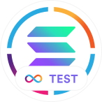
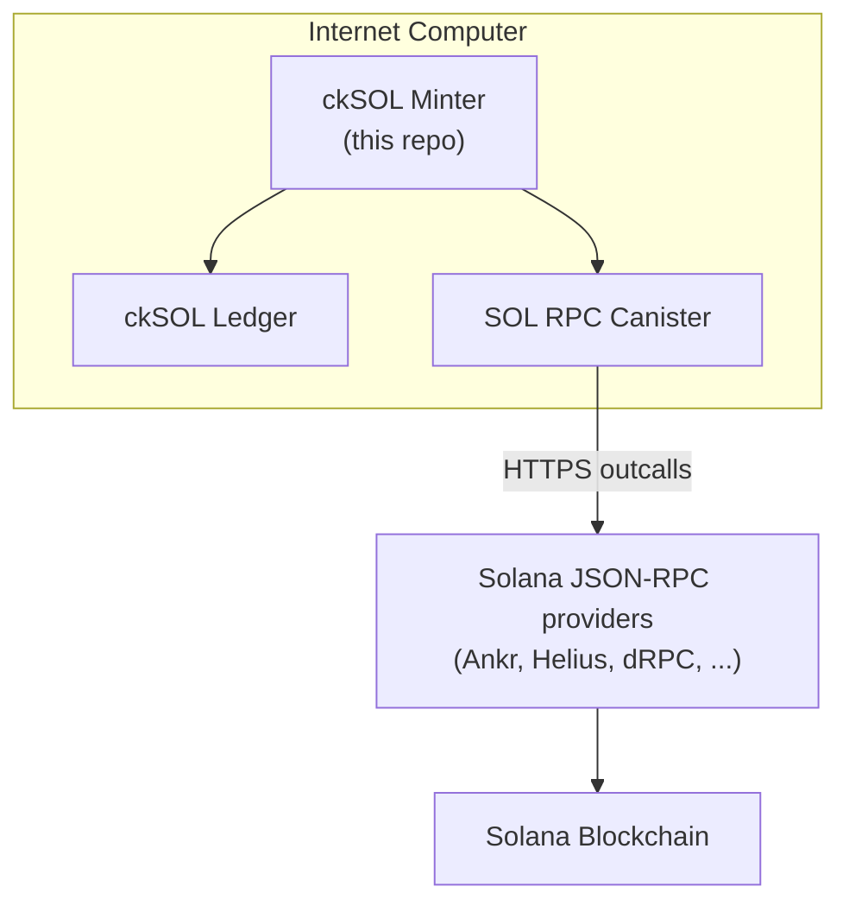

# Introduction

ckSOL is a [chain-key token](https://internetcomputer.org/how-it-works/chain-key-tokens/) on the [Internet Computer](https://internetcomputer.org/) that is backed 1:1 by SOL, the native token of the [Solana](https://solana.com/) blockchain.

Each ckSOL is backed by exactly 1 SOL held by the ckSOL minter canister. ckSOL can be converted to SOL at any time, and vice versa.

## Deployment

###  ckSOL (Solana Mainnet)

| Canister     | Canister ID                                                                                                  |
|--------------|--------------------------------------------------------------------------------------------------------------|
| Minter       | [`lh22c-kyaaa-aaaar-qb5nq-cai`](https://dashboard.internetcomputer.org/canister/lh22c-kyaaa-aaaar-qb5nq-cai) |
| Ledger       | [`ls5lp-lqaaa-aaaar-qb5oa-cai`](https://dashboard.internetcomputer.org/canister/ls5lp-lqaaa-aaaar-qb5oa-cai) |
| Ledger Index | [`2ezyf-hqaaa-aaaar-qb6ga-cai`](https://dashboard.internetcomputer.org/canister/2ezyf-hqaaa-aaaar-qb6ga-cai) |

###  ckDevnetSOL (Solana Devnet)

| Canister     | Canister ID                                                                                                  |
|--------------|--------------------------------------------------------------------------------------------------------------|
| Minter       | [`ljyxk-riaaa-aaaar-qb5mq-cai`](https://dashboard.internetcomputer.org/canister/ljyxk-riaaa-aaaar-qb5mq-cai) |
| Ledger       | [`la34w-haaaa-aaaar-qb5na-cai`](https://dashboard.internetcomputer.org/canister/la34w-haaaa-aaaar-qb5na-cai) |
| Ledger Index | [`2r6ji-gyaaa-aaaar-qb6fq-cai`](https://dashboard.internetcomputer.org/canister/2r6ji-gyaaa-aaaar-qb6fq-cai) |

## Architecture

**ckSOL Minter** — The main canister in this repository. It manages the deposit and withdrawal lifecycle, holds custody of SOL via chain-key addresses, signs Solana transactions using threshold Schnorr over Ed25519, and interacts with the ckSOL ledger.

**ckSOL Ledger** — A standard [ICRC-1/ICRC-2](https://github.com/dfinity/ICRC-1) ledger canister. It tracks ckSOL balances and processes mints and burns as instructed by the minter.

**SOL RPC Canister** — A shared infrastructure canister on the Internet Computer that relays Solana JSON-RPC calls to multiple providers via HTTPS outcalls and aggregates their responses. See the [SOL RPC canister repository](https://github.com/dfinity/sol-rpc-canister) for details.

## Where to next?

- Converting SOL to ckSOL and back? Start with [How It Works](usage/how-it-works.md), then the [command line walkthrough](usage/cli.md).
- Reviewing the system? See the [Design](development/design.md).
- Operating the canisters? See the [Deployment](development/deployment.md) guide and the [Mainnet Proposals](reference/proposals/index.md).
- Building from source? See [Building and Testing](development/building-and-testing.md).
