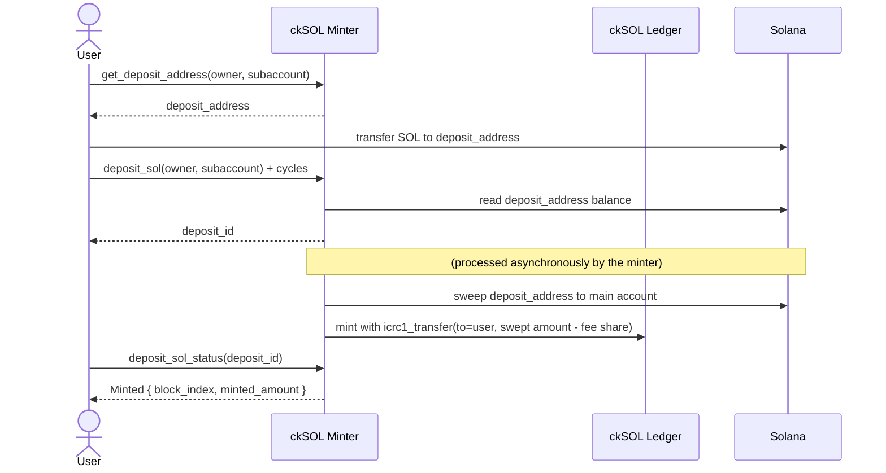
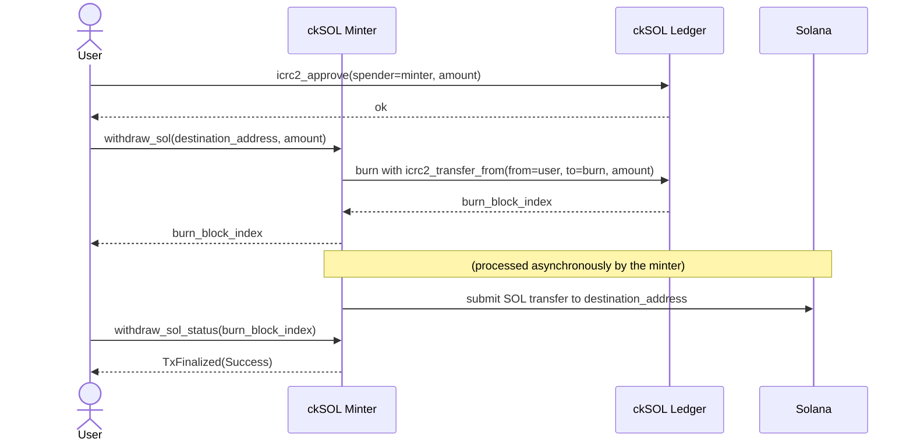

# How It Works

The ckSOL minter canister is the core component of the system. It manages the conversion between SOL and ckSOL, maintains custody of the SOL backing all outstanding ckSOL tokens, and interacts with the Solana blockchain via the [SOL RPC canister](https://github.com/dfinity/sol-rpc-canister).

The ckSOL token itself is implemented as an [ICRC-1/ICRC-2](https://github.com/dfinity/ICRC-1) ledger canister.

The minter controls one or more Solana addresses derived from a [threshold Schnorr over Ed25519](https://internetcomputer.org/docs/references/ic-interface-spec#ic-sign-with-schnorr) public key and a per-account derivation path. No private key ever exists in plaintext — Solana transactions are signed via the IC management canister's `sign_with_schnorr` API (`SchnorrAlgorithm::Ed25519`).

## Deposit: SOL → ckSOL

1. **Get a deposit address.** Call `get_deposit_address` on the minter with your ICP principal (and an optional subaccount). The minter returns a Solana address derived specifically for your account.

2. **Send SOL.** Transfer SOL to that deposit address from any Solana wallet, in one or several transfers. No memo or transaction signature is needed, so deposits can come straight from an exchange.

3. **Notify the minter.** Call `deposit_sol` on the minter with the same owner/subaccount used in step 1. This call requires attaching cycles (see `deposit_sol_required_cycles` in `get_minter_info`; unused cycles are refunded). The minter reads the balance of your deposit address, queues it for a sweep, and returns a *deposit id*.

4. **Sweep and mint.** On timers, the minter sweeps the deposit address to its main Solana account and, once the sweep transaction is finalized, mints the swept amount of ckSOL (minus the deposit's share of the sweep transaction fee) to your ICRC-1 ledger account.

5. **Track the deposit.** Call `deposit_sol_status` with the deposit id to follow the progress: `Queued` → `Swept` → `Finalized` → `Minted`.

## Withdrawal: ckSOL → SOL

1. **Approve the minter.** Grant the minter an [ICRC-2](https://github.com/dfinity/ICRC-1/blob/main/standards/ICRC-2/README.md) allowance on your ckSOL ledger account.

2. **Submit a withdrawal request.** Call `withdraw_sol` on the minter with the destination Solana address and the amount in [lamports](https://solana.com/docs/terminology#lamport). The minter:
   - Burns the requested ckSOL from your ledger account via [icrc2_transfer_from](https://github.com/dfinity/ICRC-1/blob/main/standards/ICRC-2/README.md#icrc2_transfer_from).
   - Queues the corresponding SOL transfer.

3. **Transaction submission.** The minter constructs a Solana transaction, signs it using chain-key Ed25519, and submits it via the SOL RPC canister.

4. **Monitor status.** Call `withdraw_sol_status` with the ledger burn index returned by `withdraw_sol` to track the status of your withdrawal request (`Pending` → `TxSent` → `TxFinalized`).

The full design rationale, including fees and flows, is in the [Design](../development/design.md) chapter.
